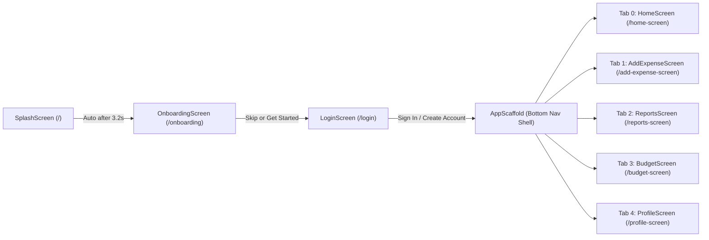

# ExpenseTra (ExpenseTracker) — Complete Project, Function & UI Analysis

This document provides a **complete, step-by-step analysis** of the **ExpenseTra (`expensetracker`)** Flutter project.
- **Part 1** details what is inside the project, its architecture, features, data models, and **every single function/method** across all files step by step.
- **Part 2** (below Part 1) provides the **Complete UI & Function Mapping Guide**, detailing every screen's visual design, UI components, animations, and how each UI element connects to its underlying function.

---

# PART 1: Project Architecture, Features & Step-by-Step Function Reference

## 1. What Is in This Project? (High-Level Overview)

**ExpenseTra** (`expensetracker` v1.0.0+1) is a cross-platform (Android, iOS, Web, Windows, macOS, Linux) personal finance and expense management application built with **Flutter** and **Material 3**.

### Tech Stack & Dependencies (`pubspec.yaml`)
| Package | Version | Purpose in Project |
| :--- | :--- | :--- |
| `flutter` | SDK `^3.9.0` | Core UI framework with Material 3 (`useMaterial3: true`) |
| `go_router` | `^14.6.1` | Declarative navigation, route transitions, and 5-tab `StatefulShellRoute.indexedStack` |
| `fl_chart` | `^0.65.0` | Interactive financial charts (14-day balance line chart, weekly spent bar chart, income bar chart, net cashflow line chart) |
| `sizer` | `^2.0.15` | Responsive screen percentage sizing (`4.w`, `2.h`, etc.) |
| `google_fonts` | `^6.1.0` | `IBM Plex Sans` typography with tabular numerals (`FontFeature.tabularFigures()`) |
| `intl` | `^0.19.0` | Date formatting (`DateFormat('MMM d · h:mm a')`, `'MMMM d, yyyy'`) |
| `flutter_svg` | `^2.0.9` | Rendering SVG assets (`img_app_logo.svg`, `sad_face.svg`) |
| `cached_network_image` | `^3.3.1` | Caching network images with progress placeholders and fallback images |
| `shared_preferences` | `^2.2.2` | Included for local key-value storage |
| `connectivity_plus` | `^6.1.4` | Exported in `app_export.dart` for network connectivity checks |
| `dio` | `^5.4.0` | Included for HTTP networking |
| `fluttertoast` | `^8.2.4` | Included for toast notifications |

### Project Directory Structure
```text
expensetracker-main/
├── assets/
│   └── images/
│       ├── img_app_logo.svg                     # App logo SVG asset
│       ├── no_image.jpg                         # Fallback placeholder image
│       └── sad_face.svg                         # Error screen SVG illustration
├── env.json                                     # API & backend environment placeholders (Supabase, OpenAI, Gemini, etc.)
├── pubspec.yaml                                 # Project manifest & dependencies
├── lib/
│   ├── main.dart                                # Application entry point, orientation lock, ErrorWidget builder, MyApp root
│   ├── core/
│   │   └── app_export.dart                      # Central barrel file exporting common packages, routes, widgets, theme
│   ├── routes/
│   │   └── app_routes.dart                      # GoRouter configuration & AppRoutes path constants
│   ├── theme/
│   │   └── app_theme.dart                       # Light & Dark Material 3 ThemeData, semantic & category color tokens
│   ├── widget/                                  # Shared / Reusable UI Widgets
│   │   ├── app_bar_widget.dart                  # Reusable top AppBar (AppBarWidget)
│   │   ├── app_navigation.dart                  # Bottom 5-tab NavigationBar (AppNavigation)
│   │   ├── app_scaffold.dart                    # Shell Scaffold wrapping bottom navigation (AppScaffold)
│   │   ├── custom_error_widget.dart             # Global fallback error screen (CustomErrorWidget)
│   │   ├── custom_icon_widget.dart              # Contains CustomImageWidget (note: filename swapped with custom_image_widget.dart)
│   │   ├── custom_image_widget.dart             # Contains CustomIconWidget with 9,000+ Material icon mappings
│   │   ├── empty_state_widget.dart              # Reusable empty state placeholder with optional CTA button
│   │   ├── loading_skeleton_widget.dart         # Shimmering animated loading skeleton box
│   │   └── state_badge_widget.dart              # Semantic status pill badge (StatusBadgeWidget)
│   └── presentation/                            # Feature Screens & Screen-Specific Widgets
│       ├── splash_screen/
│       │   └── splash_screen.dart               # Animated brand splash screen
│       ├── onboarding_screen/
│       │   └── onboarding_screen.dart           # 3-page interactive onboarding carousel
│       ├── login_screen/
│       │   └── login_screen.dart                # Sign In & Register screen with validation
│       ├── home_screen/
│       │   ├── home_screen.dart                 # Main dashboard screen + TransactionModel & BudgetModel
│       │   └── widgets/
│       │       ├── action_buttons_widget.dart   # Quick action buttons (Add, Reports, Swap/Sort)
│       │       ├── balance_display_widget.dart  # Main Account pill, % change, and $6,631.34 hero balance
│       │       ├── budget_progress_widget.dart  # Animated category budget progress bars list
│       │       ├── home_chart_widget.dart       # 14-day balance trend LineChart
│       │       └── transection_item_widget.dart # Individual transaction row item
│       ├── add_expense_screen/
│       │   ├── add_expense_screen.dart          # Expense logging form screen
│       │   └── widgets/
│       │       ├── amount_input_widget.dart     # Large $0.00 input card + quick amount chips ($5–$100)
│       │       ├── category_grid_widget.dart    # 4x2 animated grid of 8 spending categories
│       │       └── expense_form_fields_widget.dart # Merchant, Date picker trigger, and Note inputs
│       ├── reports_screen/
│       │   ├── reports_screen.dart              # Analytics & Reports screen + CategoryExpenseModel
│       │   └── widgets/
│       │       ├── category_breakdown_widget.dart # Category spending vs. budget list with over-budget warnings
│       │       ├── money_overview_widget.dart   # 2-column Income (BarChart) & Net Cashflow (LineChart) cards
│       │       ├── spent_summary_widget.dart    # Weekly grouped BarChart (This week vs Last week) + total spent
│       │       └── total_assets_widget.dart     # Animated segmented bar for Cash, Savings, and Investments
│       ├── budget_screen/
│       │   └── budget_screen.dart               # Budget Manager screen, alerts, category cards, & Edit Limit sheet
│       └── profile_screen/
│           └── profile_screen.dart              # User Profile hero, spending summary, stats, settings, & Edit Profile sheet
└── test/
    └── widget_test.dart                         # Default Flutter counter smoke test template
```

> [!NOTE]
> **Codebase Architecture Notes:**
> 1. **State Management:** All screens currently use local `StatefulWidget` state and in-memory mock data, marked with `// TODO: Replace with [Riverpod/Bloc] for production`.
> 2. **Swapped Filenames in `lib/widget/`:** `lib/widget/custom_icon_widget.dart` actually contains `CustomImageWidget`, while `lib/widget/custom_image_widget.dart` contains `CustomIconWidget`. Both are exported together via `lib/core/app_export.dart`.

---

## 2. Core Features of the Project

1. **Animated Splash Screen:** Elastic logo scale animation, sliding brand title (`ExpenseTra — Smart Money Management`), and a smooth progress bar that automatically navigates to the Onboarding Screen after ~3.2 seconds.
2. **3-Slide Onboarding Flow:** PageView carousel introducing core value propositions (*Track Every Expense Easily*, *Set Budgets, Hit Your Goals*, *Insights That Actually Help*) with animated dot indicators, elastic icon bounce, a **Skip** button, and a **Continue / Get Started** CTA.
3. **Dual-Mode Authentication (Sign In / Register):** Toggleable tab card supporting both **Sign In** (Email + Password) and **Register** (Full Name + Email + Password + Confirm Password) with form validation, show/hide password toggles, simulated async submission, and Google/Apple social button UI.
4. **Stateful Bottom Navigation Shell:** 5 persistent tabs (**Home**, **Add**, **Reports**, **Budget**, **Profile**) powered by `StatefulShellRoute.indexedStack` so each tab preserves its scroll position and state.
5. **Home Financial Dashboard:**
   - Interactive 14-day balance trend `LineChart` with touch tooltips.
   - Centered hero balance (`$6,631.34`) with account status dot and percentage change indicator.
   - Tactile scale-animated quick action buttons (**Add**, **Reports**, and **Transfer/Swap**).
   - Staggered-animation **Recent Transactions** list distinguishing credits (`+$3200.00` in green) and debits (`-$73.42`).
   - Animated **Monthly Budgets** progress list with automatic color coding (normal category color, orange warning at `>80%`, red error when over budget).
6. **Add Expense Workflow:**
   - Large `$0.00` tabular numeric input with regex decimal filtering (`^\d+\.?\d{0,2}`) and 1-tap quick chips (`$5`, `$10`, `$20`, `$50`, `$100`).
   - 8-category 4x2 grid (`Food`, `Transport`, `Shopping`, `Health`, `Entertainment`, `Bills`, `Travel`, `Other`) with press-scale animation.
   - Merchant/Payee validation, Material Date Picker (`2020` to `today`), and optional multi-line Note input.
   - Validation snackbar if no category is selected, loading state on submit, and a confirmation dialog with **Add Another** (resets form) or **Done**.
7. **Financial Analytics & Reports:**
   - Month selector bottom sheet (`Jan` through `Jul`).
   - **Spent Summary Card:** Total monthly spent (`$1,184.65`), current week spent (`$252.61`), 4-week grouped `BarChart` comparing *This week* vs. *Last week*, and `% vs avg` / `% last week` chips.
   - **Total Assets Card:** `$15,210.00` total divided into an animated 3-segment bar (`Cash $2,450`, `Savings $8,920`, `Invest $3,840`).
   - **Money Overview 2-Column Grid:** **Income** (`$1,120.00` with 6-bar mini chart) and **Net Cashflow** (`-$45.34` with dual-color positive/negative mini line chart).
   - **By Category Breakdown:** Animated progress bars for 7 categories with explicit `"Over by $27.45"` warning rows.
8. **Interactive Budget Manager:**
   - Gradient **Monthly Budget Overview Card** dynamically summing total budget, total spent, remaining budget, `% used`, and count of categories `"OK"`.
   - Dynamic **Alert Banner** showing how many categories exceeded their budget (red) or are approaching `>=85%` of their limit (orange).
   - **Interactive Limit Editing:** Tapping any category opens a modal bottom sheet (`_EditLimitSheet`) with quick chips (`$100`, `$200`, `$300`, `$500`, `$1000`) and live state updates that immediately recalculate all totals and banners on save.
   - **Budget Tips Dialog:** Info button in the AppBar opens a dialog explaining the *50/30/20 Rule*, *Track Weekly*, and *Buffer Zone*.
9. **User Profile & Preferences:**
   - Collapsible `SliverAppBar` hero with network avatar, name (`Alex Morgan`), email, and member date.
   - Monthly Spending summary (`$2,148.75 of $3,500`, `61% used`, `$1,351.25 saved`), Top Spending Categories card, and 3 KPI stat cards (`47 Transactions`, `$83 Avg / Day`, `87% Budget Score`).
   - Interactive settings groups (**Account Settings**, **Preferences** with live `Notifications` and `Biometric Login` switches, **Support**), **Edit Profile** modal bottom sheet, and **Sign Out** confirmation dialog.
10. **Adaptive Phone & Tablet Layouts:**
    - Screens detect `_isTablet` (`MediaQuery.of(context).size.width >= 600`) and switch from single-column phone scrolling to 2-column 60%/40% split layouts (`HomeScreen`, `ReportsScreen`) or centered `maxWidth: 480` constrained forms (`AddExpenseScreen`).

---

## 3. Step-by-Step Detailed Breakdown of Every File & Function

### Step 1: Application Entry Point & Core Exports
#### File: [`lib/main.dart`](file:///C:/Users/1070/Downloads/expensetracker-main/expensetracker-main/lib/main.dart)
- **`main()`** (`Future<void> main() async`, lines 9–37):
  1. Calls `WidgetsFlutterBinding.ensureInitialized()` to initialize Flutter engine bindings.
  2. Sets a custom `ErrorWidget.builder` that renders `CustomErrorWidget(errorDetails: details)` once and throttles duplicate error widgets for 5 seconds using `hasShownError` and `Future.delayed(Duration(seconds: 5))`.
  3. Sets `GoRouter.optionURLReflectsImperativeAPIs = true` so browser URLs update on imperative navigation.
  4. Locks device orientation to portrait (`DeviceOrientation.portraitUp`) on mobile devices (`!kIsWeb`).
  5. Launches the root widget via `runApp(MyApp())`.
- **Class `MyApp`** (`StatelessWidget`, lines 39–67):
  - **`build(BuildContext context)`**:
    - Wraps the app in a `Sizer` widget for responsive sizing.
    - Returns `MaterialApp.router` configured with `AppTheme.lightTheme`, `AppTheme.darkTheme`, `ThemeMode.light`, and `routerConfig: appRouter`.
    - Overrides `MediaQuery` inside `builder` to lock `textScaler: TextScaler.linear(1.0)` so OS font scaling does not break fixed UI layouts.

#### File: [`lib/core/app_export.dart`](file:///C:/Users/1070/Downloads/expensetracker-main/expensetracker-main/lib/core/app_export.dart)
- Barrel export file that re-exports `connectivity_plus`, `google_fonts`, `go_router`, `app_routes.dart`, `custom_icon_widget.dart`, `custom_image_widget.dart`, and `app_theme.dart`.

---

### Step 2: Application Routing
#### File: [`lib/routes/app_routes.dart`](file:///C:/Users/1070/Downloads/expensetracker-main/expensetracker-main/lib/routes/app_routes.dart)
- **Class `AppRoutes`** (lines 13–23):
  - Static route path constants:
    - `initial = '/'`
    - `splashScreen = '/'`
    - `onboardingScreen = '/onboarding'`
    - `loginScreen = '/login'`
    - `homeScreen = '/home-screen'`
    - `addExpenseScreen = '/add-expense-screen'`
    - `reportsScreen = '/reports-screen'`
    - `budgetScreen = '/budget-screen'`
    - `profileScreen = '/profile-screen'`
- **Global `appRouter`** (`GoRouter`, lines 25–116):
  - **`GoRoute(path: '/')`**: Builds `SplashScreen` with a 300ms `FadeTransition` (`Curves.easeOut`).
  - **`GoRoute(path: '/onboarding')`**: Builds `OnboardingScreen` with a 350ms `FadeTransition` (`Curves.easeOut`).
  - **`GoRoute(path: '/login')`**: Builds `LoginScreen` with a 350ms combined upward `SlideTransition` (`Offset(0, 0.08)` to `Offset.zero`) and `FadeTransition`.
  - **`StatefulShellRoute.indexedStack`**: Wraps 5 `StatefulShellBranch` routes inside `AppScaffold(navigationShell: navigationShell)`:
    - Branch 0: `/home-screen` -> `HomeScreen()`
    - Branch 1: `/add-expense-screen` -> `AddExpenseScreen()`
    - Branch 2: `/reports-screen` -> `ReportsScreen()`
    - Branch 3: `/budget-screen` -> `BudgetScreen()`
    - Branch 4: `/profile-screen` -> `ProfileScreen()`

---

### Step 3: Theme & Color System
#### File: [`lib/theme/app_theme.dart`](file:///C:/Users/1070/Downloads/expensetracker-main/expensetracker-main/lib/theme/app_theme.dart)
- **Class `AppTheme`** (lines 7–282):
  - **Static Color Constants**:
    - Brand: `primary` (`#1B5E20`), `primaryContainer` (`#A5D6A7`), `primaryMuted` (`#4CAF50`), `secondary` (`#00897B`), `secondaryContainer` (`#B2DFDB`).
    - Semantic: `success` (`#2E7D32`), `warning` (`#E65100`), `warningContainer` (`#FFE0B2`), `error` (`#C62828`), `errorContainer` (`#FFCDD2`).
    - Surfaces: `surfaceLight` (`#FFFFFF`), `surfaceVariantLight` (`#F5F5F5`), `backgroundLight` (`#F8F9FA`), `outlineLight` (`#E0E0E0`), `outlineVariantLight` (`#F0F0F0`), plus dark equivalents.
    - Category Colors: `catFood` (`#EF6C00`), `catTransport` (`#1565C0`), `catShopping` (`#6A1B9A`), `catHealth` (`#AD1457`), `catEntertainment` (`#00838F`), `catBills` (`#37474F`), `catTravel` (`#2E7D32`), `catOther` (`#795548`).
  - **Getter `lightTheme`** (`ThemeData`, lines 44–189): Configures Material 3 `ColorScheme.light`, `GoogleFonts.ibmPlexSansTextTheme`, `AppBarThemeData`, `CardThemeData` (radius 16), `InputDecorationThemeData` (radius 12), `NavigationBarThemeData` (height 68), `DividerThemeData`, and `ChipThemeData`.
  - **Getter `darkTheme`** (`ThemeData`, lines 191–281): Configures Material 3 `ColorScheme.dark` with dark green surfaces (`#121812`, `#1E2A1E`) and light text (`#E6E6E6`).

---

### Step 4: Shared / Reusable Widgets (`lib/widget/`)

#### 4.1 [`lib/widget/app_bar_widget.dart`](file:///C:/Users/1070/Downloads/expensetracker-main/expensetracker-main/lib/widget/app_bar_widget.dart)
- **Class `AppBarWidget`** (`StatelessWidget implements PreferredSizeWidget`):
  - **`preferredSize` getter**: Returns `Size.fromHeight(60)`.
  - **`build(BuildContext context)`**: Renders a Material `AppBar` with custom `title`, optional `actions`, and conditional back button (`Navigator.of(context).pop()` when `showBackButton == true`).

#### 4.2 [`lib/widget/app_scaffold.dart`](file:///C:/Users/1070/Downloads/expensetracker-main/expensetracker-main/lib/widget/app_scaffold.dart)
- **Class `AppScaffold`** (`StatelessWidget`):
  - **`build(BuildContext context)`**: Renders the main shell `Scaffold` with `body: navigationShell` and `bottomNavigationBar: AppNavigation(navigationShell: navigationShell)`.

#### 4.3 [`lib/widget/app_navigation.dart`](file:///C:/Users/1070/Downloads/expensetracker-main/expensetracker-main/lib/widget/app_navigation.dart)
- **Class `_TabSpec`**: Data holder for `label`, `icon`, `selectedIcon`, and `branchIndex`.
- **Class `AppNavigation` & `_AppNavigationState`**:
  - **`_onTap(int visualIndex)`** (lines 66–78): Checks if the tapped tab has a valid `branchIndex`, updates `_selectedVisualIndex` in state, and calls `widget.navigationShell.goBranch(tab.branchIndex!, initialLocation: tab.branchIndex == widget.navigationShell.currentIndex)`.
  - **`build(BuildContext context)`** (lines 80–105): Renders Material 3 `NavigationBar` with 5 `NavigationDestination` items (`Home`, `Add`, `Reports`, `Budget`, `Profile`).

#### 4.4 [`lib/widget/custom_error_widget.dart`](file:///C:/Users/1070/Downloads/expensetracker-main/expensetracker-main/lib/widget/custom_error_widget.dart)
- **Class `CustomErrorWidget`** (`StatelessWidget`):
  - **`build(BuildContext context)`**: Renders `assets/images/sad_face.svg`, `"Something went wrong"` heading, explanatory text, and a **Back** `ElevatedButton.icon` that calls `context.pop()` if `context.canPop()` is true, or `context.goNamed(AppRoutes.initial)` otherwise.

#### 4.5 [`lib/widget/custom_icon_widget.dart`](file:///C:/Users/1070/Downloads/expensetracker-main/expensetracker-main/lib/widget/custom_icon_widget.dart) *(Contains `CustomImageWidget`)*
- **Extension `ImageTypeExtension on String`**:
  - **`imageType` getter**: Inspects URL/path string to return `ImageType.network` (`http`/`https`), `ImageType.svg` (`.svg`), `ImageType.file` (`file: //`), or `ImageType.png` (default).
- **Class `CustomImageWidget`** (`StatelessWidget`):
  - **`build(BuildContext context)`**: Optionally wraps `_buildWidget()` in an `Align` widget.
  - **`_buildWidget()`**: Wraps `_buildCircleImage()` in `Padding` and `InkWell(onTap: onTap)`.
  - **`_buildCircleImage()`**: Applies `ClipRRect(borderRadius: radius)` if `radius != null`.
  - **`_buildImageWithBorder()`**: Wraps `_buildImageView()` in a bordered `Container` if `border != null`.
  - **`_buildImageView()`**: Switches on `imageUrl!.imageType` to render `SvgPicture.asset`, `Image.file`, `CachedNetworkImage`, or `Image.asset`.

#### 4.6 [`lib/widget/custom_image_widget.dart`](file:///C:/Users/1070/Downloads/expensetracker-main/expensetracker-main/lib/widget/custom_image_widget.dart) *(Contains `CustomIconWidget`)*
- **Class `CustomIconWidget`** (`StatelessWidget`):
  - **`build(BuildContext context)`**: Looks up `iconName` in a 9,000+ entry `Map<String, IconData> iconMap` and returns `Icon(iconMap[iconName], size: size, color: color)`, or fallback `Icon(Icons.help_outline)` if not found.

#### 4.7 [`lib/widget/empty_state_widget.dart`](file:///C:/Users/1070/Downloads/expensetracker-main/expensetracker-main/lib/widget/empty_state_widget.dart)
- **Class `EmptyStateWidget`** (`StatelessWidget`):
  - **`build(BuildContext context)`**: Renders a centered 72px `Icon`, `title`, `description`, and an optional `FilledButton.icon` when `ctaLabel` and `onCta` are provided.

#### 4.8 [`lib/widget/loading_skeleton_widget.dart`](file:///C:/Users/1070/Downloads/expensetracker-main/expensetracker-main/lib/widget/loading_skeleton_widget.dart)
- **Class `LoadingSkeletonWidget` & `_LoadingSkeletonWidgetState`**:
  - **`initState()`**: Creates a repeating 1200ms `AnimationController` with a `Tween<double>(begin: -0.5, end: 1.5)` curved animation.
  - **`dispose()`**: Disposes `_controller`.
  - **`build(BuildContext context)`**: Renders an `AnimatedBuilder` driving a 3-stop `LinearGradient` shimmer effect across a rounded `Container`.

#### 4.9 [`lib/widget/state_badge_widget.dart`](file:///C:/Users/1070/Downloads/expensetracker-main/expensetracker-main/lib/widget/state_badge_widget.dart)
- **Enum `BadgeStatus`**: `{ success, warning, error, neutral, info }`.
- **Class `StatusBadgeWidget`** (`StatelessWidget`):
  - **`_bgColor()`**: Returns a translucent background color matching `status`.
  - **`_textColor()`**: Returns the foreground text color matching `status`.
  - **`build(BuildContext context)`**: Renders a compact rounded pill `Container` with `label`.

---

### Step 5: Splash Screen
#### File: [`lib/presentation/splash_screen/splash_screen.dart`](file:///C:/Users/1070/Downloads/expensetracker-main/expensetracker-main/lib/presentation/splash_screen/splash_screen.dart)
- **Class `SplashScreen` & `_SplashScreenState`**:
  - **`initState()`** (lines 28–72): Initializes 3 animation controllers (`_logoController` 900ms, `_textController` 700ms, `_progressController` 1800ms) and 5 animations (`_logoScale` with `Curves.elasticOut`, `_logoOpacity`, `_textOpacity`, `_textSlide`, `_progressValue`), then invokes `_startAnimations()`.
  - **`_startAnimations()`** (`Future<void>`, lines 74–85):
    1. Waits 200ms, then starts `_logoController.forward()`.
    2. Waits 500ms, then starts `_textController.forward()`.
    3. Waits 300ms, then starts `_progressController.forward()`.
    4. Waits 2200ms, then checks `if (mounted)` and navigates to `context.go(AppRoutes.onboardingScreen)`.
  - **`dispose()`** (lines 88–93): Disposes all 3 `AnimationController` instances.
  - **`build(BuildContext context)`** (lines 96–266): Renders the deep green (`AppTheme.primary`) splash screen with 3 translucent background circles, animated white wallet logo card, animated `"ExpenseTra"` + `"Smart Money Management"` text, and bottom `"Loading..."` `LinearProgressIndicator`.

---

### Step 6: Onboarding Screen
#### File: [`lib/presentation/onboarding_screen/onboarding_screen.dart`](file:///C:/Users/1070/Downloads/expensetracker-main/expensetracker-main/lib/presentation/onboarding_screen/onboarding_screen.dart)
- **Class `_OnboardingPage`** (lines 8–24): Immutable model holding `title`, `subtitle`, `icon`, `iconBg`, `iconColor`, and `gradientColors` for each slide.
- **Class `OnboardingScreen` & `_OnboardingScreenState`**:
  - **`initState()`** (lines 72–82): Initializes `_iconController` (600ms) and `_iconBounce` (`Tween(begin: 0.8, end: 1.0)` with `Curves.elasticOut`) and starts `_iconController.forward()`.
  - **`dispose()`** (lines 85–89): Disposes `_pageController` and `_iconController`.
  - **`_nextPage()`** (lines 91–100): If `_currentPage < _pages.length - 1`, animates `_pageController.nextPage` (400ms, `Curves.easeInOutCubic`); otherwise navigates to `context.go(AppRoutes.loginScreen)`.
  - **`_skip()`** (lines 102–104): Immediately navigates to `context.go(AppRoutes.loginScreen)`.
  - **`build(BuildContext context)`** (lines 107–237): Renders the top indicator dots + **Skip** button, the `PageView.builder` (which resets and replays `_iconController` on page change), the primary **Continue / Get Started** button, and the `"Already have an account? Sign In"` link on the final slide.
  - **`_buildPage(_OnboardingPage page)`** (lines 239–289): Renders a single onboarding slide with a 180x180 circular icon container (scaled by `_iconBounce`), bold 28px title, and 15px subtitle.

---

### Step 7: Login & Registration Screen
#### File: [`lib/presentation/login_screen/login_screen.dart`](file:///C:/Users/1070/Downloads/expensetracker-main/expensetracker-main/lib/presentation/login_screen/login_screen.dart)
- **Class `LoginScreen` & `_LoginScreenState`**:
  - **State Fields**: `_formKey`, `_emailController`, `_passwordController`, `_nameController`, `_confirmPasswordController`, `_obscurePassword`, `_obscureConfirm`, `_isLoading`, `_isRegisterMode`, `_slideController`, `_slideAnimation`.
  - **`initState()`** (lines 31–42): Sets up `_slideController` (350ms) and `_slideAnimation` (`Offset(0, 0.06)` to `Offset.zero`) and plays it forward.
  - **`dispose()`** (lines 45–52): Disposes all 4 `TextEditingController`s and `_slideController`.
  - **`_toggleMode()`** (lines 54–61): Toggles `_isRegisterMode` between Sign In (`false`) and Register (`true`), resets form validation errors (`_formKey.currentState?.reset()`), and replays the card slide animation.
  - **`_submit()`** (`Future<void>`, lines 63–71):
    1. Validates the form via `_formKey.currentState!.validate()`.
    2. Sets `_isLoading = true` and awaits a simulated 1200ms network delay.
    3. Resets `_isLoading = false` and navigates to `context.go(AppRoutes.homeScreen)`.
  - **`build(BuildContext context)`** (lines 74–432): Renders the curved green header (`Welcome Back` / `Create Account`), the floating white form card, mode switcher tabs, conditional form fields, **Forgot Password?** button, submit button with spinner, Google/Apple social login buttons, and bottom mode toggle link.
  - **`_buildTab(String label, bool isActive)`** (lines 434–469): Builds an animated segmented tab button (`Sign In` or `Register`) that triggers `_toggleMode()` when tapped while inactive.
  - **`_buildLabel(String text)`** (lines 471–480): Builds a 13px bold field label above an input.
  - **`_buildTextField({...})`** (lines 482–528): Builds a styled `TextFormField` with prefix icon, optional suffix icon (password visibility toggle), validation logic, and rounded borders.
  - **`_buildSocialButton({required IconData icon, required String label, required VoidCallback onTap})`** (lines 530–561): Builds the bordered **Google** and **Apple** social login buttons.

---

### Step 8: Home Screen & Dashboard Widgets

#### 8.1 [`lib/presentation/home_screen/home_screen.dart`](file:///C:/Users/1070/Downloads/expensetracker-main/expensetracker-main/lib/presentation/home_screen/home_screen.dart)
- **Class `TransactionModel`** (lines 15–51):
  - Fields: `id`, `merchant`, `category`, `categoryIcon`, `amount`, `isCredit`, `date`, `subAmount`, `iconColor`.
  - **`TransactionModel.fromMap(Map<String, dynamic> map)`**: Factory constructor parsing raw transaction map data (including `DateTime.parse` and `Color(int)`).
- **Class `BudgetModel`** (lines 53–85):
  - Fields: `id`, `category`, `icon`, `budgetAmount`, `spentAmount`, `color`.
  - **`progress` getter**: `(spentAmount / budgetAmount).clamp(0.0, 1.0)`.
  - **`remaining` getter**: `budgetAmount - spentAmount`.
  - **`isOverBudget` getter**: `spentAmount > budgetAmount`.
  - **`isAtRisk` getter**: `progress > 0.8 && !isOverBudget`.
  - **`BudgetModel.fromMap(Map<String, dynamic> map)`**: Factory constructor parsing raw budget map data.
- **Class `HomeScreen` & `_HomeScreenState`**:
  - **`initState()`** (lines 213–222): Maps `_transactionMaps` (6 mock transactions) to `_transactions` and `_budgetMaps` (5 mock budgets) to `_budgets`. Initializes `_listAnimController` (600ms) and starts it via `Future.microtask`.
  - **`dispose()`** (lines 225–228): Disposes `_listAnimController`.
  - **`_isTablet` getter** (line 230): Returns `true` when `MediaQuery.of(context).size.width >= 600`.
  - **`build(BuildContext context)`** (lines 233–241): Renders `Scaffold` choosing between `_buildTabletLayout(theme)` and `_buildPhoneLayout(theme)`.
  - **`_buildPhoneLayout(ThemeData theme)`** (lines 243–281): Single-column `CustomScrollView` containing `_buildSliverAppBar`, `HomeChartWidget`, `BalanceDisplayWidget`, `ActionButtonsWidget`, Recent Transactions (`_buildTransactionList`), and Monthly Budgets (`BudgetProgressWidget`).
  - **`_buildTabletLayout(ThemeData theme)`** (lines 283–341): 2-column split `Row` (Left `flex: 6` with chart, balance, actions, and transactions; Right `flex: 4` with Monthly Budgets).
  - **`_buildSliverAppBar(ThemeData theme)`** (lines 343–394): Floating/snapping `SliverAppBar` with `"ET"` badge, `"ExpenseTracker"` title, search button, and notifications button.
  - **`_buildSectionHeader(ThemeData theme, String title, {VoidCallback? onSeeAll})`** (lines 396–432): Renders section title with a `"See all"` button.
  - **`_buildTransactionList(ThemeData theme)`** (lines 434–489): Renders a white card containing staggered `FadeTransition` + `SlideTransition` `TransactionItemWidget` rows separated by `Divider`s.

#### 8.2 [`lib/presentation/home_screen/widgets/home_chart_widget.dart`](file:///C:/Users/1070/Downloads/expensetracker-main/expensetracker-main/lib/presentation/home_screen/widgets/home_chart_widget.dart)
- **Class `HomeChartWidget`** (`StatelessWidget`):
  - **`_buildSpots()`** (lines 12–30): Returns 14 `FlSpot` points (`x: 0..13`, `y: 4820..6631`) representing a 14-day balance trend.
  - **`build(BuildContext context)`** (lines 33–101): Renders a 160px tall `LineChart` with smooth curves (`curveSmoothness: 0.35`), gradient fill under the line, a highlighted dot on the latest data point (`spot.x == 13`), and interactive touch tooltips showing `\$${s.y.toStringAsFixed(0)}`.

#### 8.3 [`lib/presentation/home_screen/widgets/balance_display_widget.dart`](file:///C:/Users/1070/Downloads/expensetracker-main/expensetracker-main/lib/presentation/home_screen/widgets/balance_display_widget.dart)
- **Class `BalanceDisplayWidget`** (`StatelessWidget`):
  - **`build(BuildContext context)`** (lines 19–115): Renders the `"Main Account"` pill with a green/red status dot, the upward/downward arrow with change percentage (`87.90% ▲1.74%`), and the large tabular `RichText` balance splitting whole dollars (`44px bold`) and cents (`28px regular`, e.g., `$6631` + `.34`).

#### 8.4 [`lib/presentation/home_screen/widgets/action_buttons_widget.dart`](file:///C:/Users/1070/Downloads/expensetracker-main/expensetracker-main/lib/presentation/home_screen/widgets/action_buttons_widget.dart)
- **Class `ActionButtonsWidget`** (`StatelessWidget`):
  - **`build(BuildContext context)`** (lines 17–45): Renders a `Row` with two expanded `_ActionButton`s (`Add` -> `onAdd`, `Reports` -> `onReports`) and one `_SquareActionButton` (`Icons.swap_vert_rounded`).
- **Class `_ActionButton` & `_ActionButtonState`**:
  - **`initState()` / `dispose()`**: Manages a 100ms `_scaleController` (`0.96` to `1.0`) for press-down tactile feedback.
  - **`build(BuildContext context)`**: Wraps the green pill button in a `ScaleTransition` and `GestureDetector` (`onTapDown` shrinks to `0.96`, `onTapUp` restores to `1.0` and invokes `widget.onTap()`).
- **Class `_SquareActionButton`**:
  - **`build(BuildContext context)`**: Renders a 50x50 rounded square icon button with `InkWell` splash.

#### 8.5 [`lib/presentation/home_screen/widgets/transection_item_widget.dart`](file:///C:/Users/1070/Downloads/expensetracker-main/expensetracker-main/lib/presentation/home_screen/widgets/transection_item_widget.dart)
- **Class `TransactionItemWidget`** (`StatelessWidget`):
  - **`_formatDate(DateTime date)`** (lines 13–22): Formats `date` relative to `DateTime.now()` as `"Today · h:mm a"`, `"Yesterday · h:mm a"`, or `"MMM d · h:mm a"`.
  - **`build(BuildContext context)`** (lines 25–122): Renders a transaction row with a 44x44 tinted circular category icon, merchant name, formatted date, signed tabular amount (`+$3200.00` in green or `-$73.42` in dark text), and category badge.
  - **`_iconFromName(String name)`** (lines 124–141): Maps string icon keys (`shopping_basket`, `directions_car`, `play_circle`, `account_balance`, `local_pharmacy`, `local_cafe`) to `IconData`.

#### 8.6 [`lib/presentation/home_screen/widgets/budget_progress_widget.dart`](file:///C:/Users/1070/Downloads/expensetracker-main/expensetracker-main/lib/presentation/home_screen/widgets/budget_progress_widget.dart)
- **Class `BudgetProgressWidget` & `_BudgetProgressWidgetState`**:
  - **`initState()` / `dispose()`**: Manages an 800ms `_barController` (`Curves.easeOutCubic`) that animates all budget progress bars from `0` to `budget.progress`.
  - **`build(BuildContext context)`**: Renders a rounded white card containing `_BudgetItemRow`s separated by `Divider`s.
- **Class `_BudgetItemRow`**:
  - **`build(BuildContext context)`**: Determines `progressColor` (`AppTheme.error` if over budget, `AppTheme.warning` if `>80%`, else `budget.color`), renders category icon, name, `$spent / $budget`, `"Over budget"` or `"$X left"`, and the animated `LinearProgressIndicator`.
  - **`_iconFromName(String name)`**: Maps budget icon strings to `IconData`.

---

### Step 9: Add Expense Screen & Form Widgets

#### 9.1 [`lib/presentation/add_expense_screen/add_expense_screen.dart`](file:///C:/Users/1070/Downloads/expensetracker-main/expensetracker-main/lib/presentation/add_expense_screen/add_expense_screen.dart)
- **Class `AddExpenseScreen` & `_AddExpenseScreenState`**:
  - **State Fields**: `_formKey`, `_amountController`, `_noteController`, `_merchantController`, `_selectedCategory`, `_selectedDate`, `_isSubmitting`, `_enterAnim`, `_fadeAnim`, `_slideAnim`.
  - **`initState()` / `dispose()`** (lines 36–57): Manages the 450ms entrance fade/slide animation and disposes all controllers.
  - **`_isTablet` getter** (line 59): Checks `MediaQuery.of(context).size.width >= 600`.
  - **`_selectDate()`** (`Future<void>`, lines 61–79): Opens Flutter's `showDatePicker` themed with `AppTheme.primary` (range `2020` to `DateTime.now()`) and updates `_selectedDate` on selection.
  - **`_submit()`** (`Future<void>`, lines 81–106):
    1. Validates text inputs via `_formKey.currentState!.validate()`.
    2. Checks if `_selectedCategory.isEmpty`; if empty, displays a floating red error `SnackBar` (`"Please select a category"`).
    3. Sets `_isSubmitting = true`, waits 800ms to simulate saving, sets `_isSubmitting = false`, and calls `_showSuccessDialog()`.
  - **`_showSuccessDialog()`** (lines 108–174): Displays a rounded `AlertDialog` with a green checkmark, `"Expense Added!"`, `"$<amount> in <category> has been logged."`, an **Add Another** button (pops dialog + calls `_resetForm()`), and a **Done** button (pops dialog).
  - **`_resetForm()`** (lines 176–184): Clears `_amountController`, `_noteController`, and `_merchantController`, and resets `_selectedCategory = ''` and `_selectedDate = DateTime.now()`.
  - **`build(BuildContext context)`** (lines 187–214): Renders `Scaffold` with `AppBarWidget` (including a close/reset `X` icon button) and responsive body.
  - **`_buildPhoneLayout(ThemeData theme)`** (lines 216–249) & **`_buildTabletLayout(ThemeData theme)`** (lines 251–289): Renders the `Form` containing `AmountInputWidget`, `CategoryGridWidget`, `ExpenseFormFieldsWidget`, and `_buildSubmitButton`. Tablet layout constrains width to `480px`.
  - **`_buildSectionLabel(ThemeData theme, String label)`** (lines 291–301): Renders `"Category"` and `"Details"` section headers.
  - **`_buildSubmitButton(ThemeData theme)`** (lines 303–340): Renders a full-width 54px `FilledButton` with an `AnimatedSwitcher` toggling between `"Add Expense"` and a white `CircularProgressIndicator`.

#### 9.2 [`lib/presentation/add_expense_screen/widgets/amount_input_widget.dart`](file:///C:/Users/1070/Downloads/expensetracker-main/expensetracker-main/lib/presentation/add_expense_screen/widgets/amount_input_widget.dart)
- **Class `AmountInputWidget` & `_AmountInputWidgetState`**:
  - **`build(BuildContext context)`** (lines 19–140):
    - Renders a white card with `"Amount"` label, a 36px `$` prefix, and a 44px bold `TextFormField` filtered by `FilteringTextInputFormatter.allow(RegExp(r'^\d+\.?\d{0,2}'))`.
    - Validates that the input is non-empty and parses to a `double > 0`.
    - Renders a horizontal scroll row of 5 quick-amount chips (`$5`, `$10`, `$20`, `$50`, `$100`) that set `widget.controller.text = amt.toStringAsFixed(2)` when tapped.

#### 9.3 [`lib/presentation/add_expense_screen/widgets/category_grid_widget.dart`](file:///C:/Users/1070/Downloads/expensetracker-main/expensetracker-main/lib/presentation/add_expense_screen/widgets/category_grid_widget.dart)
- **Class `_CategoryItem`**: Holds `label`, `icon`, and `color` for the 8 categories (`Food`, `Transport`, `Shopping`, `Health`, `Entertainment`, `Bills`, `Travel`, `Other`).
- **Class `CategoryGridWidget`** (`StatelessWidget`):
  - **`build(BuildContext context)`** (lines 72–93): Renders a non-scrollable 4-column `GridView.builder` of `_CategoryTile` widgets.
- **Class `_CategoryTile` & `_CategoryTileState`**:
  - **`initState()` / `dispose()`**: Manages a 120ms `_scaleCtrl` (`0.92` to `1.0`) for tap bounce.
  - **`build(BuildContext context)`**: Renders an `AnimatedContainer` that highlights border, background tint, icon color, and shadow using `widget.item.color` when `widget.isSelected` is true.

#### 9.4 [`lib/presentation/add_expense_screen/widgets/expense_form_fields_widget.dart`](file:///C:/Users/1070/Downloads/expensetracker-main/expensetracker-main/lib/presentation/add_expense_screen/widgets/expense_form_fields_widget.dart)
- **Class `ExpenseFormFieldsWidget`** (`StatelessWidget`):
  - **`build(BuildContext context)`** (lines 22–163): Renders a white card containing:
    1. **Merchant / Payee** `TextFormField` (validates non-empty string).
    2. **Date Selector** `InkWell` row displaying `DateFormat('MMMM d, yyyy').format(selectedDate)` and triggering `onDateTap`.
    3. **Note (optional)** multi-line `TextFormField` (`minLines: 2`, `maxLines: 3`).

---

### Step 10: Reports / Analytics Screen & Chart Widgets

#### 10.1 [`lib/presentation/reports_screen/reports_screen.dart`](file:///C:/Users/1070/Downloads/expensetracker-main/expensetracker-main/lib/presentation/reports_screen/reports_screen.dart)
- **Class `CategoryExpenseModel`** (lines 12–59):
  - Fields: `name`, `icon`, `color`, `spent`, `budget`.
  - **`progress` getter**: `(spent / budget).clamp(0.0, 1.0)`.
  - **`CategoryExpenseModel.fromMap(Map<String, dynamic> map)`**: Factory constructor converting map data into model instances.
  - **`_iconFromName(String name)`**: Static helper mapping icon names to Material `IconData`.
- **Class `ReportsScreen` & `_ReportsScreenState`**:
  - **`initState()`** (lines 136–139): Populates `_categories` from `_categoryMaps` (7 spending categories).
  - **`_isTablet` getter** (line 141): Checks `MediaQuery.of(context).size.width >= 600`.
  - **`build(BuildContext context)`** (lines 144–154): Renders `Scaffold` with `_buildAppBar(theme)` and phone/tablet body.
  - **`_buildAppBar(ThemeData theme)`** (lines 156–206): Renders `"Analytics"` title and the interactive month selector button (`_selectedMonth`, default `'Jul'`) that triggers `_showMonthPicker`.
  - **`_showMonthPicker()`** (lines 208–269): Opens a modal bottom sheet displaying selectable month chips (`Jan`–`Jul`); tapping a chip updates `_selectedMonth` and closes the sheet.
  - **`_buildPhoneLayout()`** (lines 271–300): Single-column scroll view with `SpentSummaryWidget`, `TotalAssetsWidget`, `MoneyOverviewWidget`, and `CategoryBreakdownWidget`.
  - **`_buildTabletLayout()`** (lines 302–345): 2-column split `Row` (Left `flex: 6`: `SpentSummaryWidget` + `MoneyOverviewWidget`; Right `flex: 4`: `TotalAssetsWidget` + `CategoryBreakdownWidget`).

#### 10.2 [`lib/presentation/reports_screen/widgets/spent_summary_widget.dart`](file:///C:/Users/1070/Downloads/expensetracker-main/expensetracker-main/lib/presentation/reports_screen/widgets/spent_summary_widget.dart)
- **Class `SpentSummaryWidget`** (`StatelessWidget`):
  - **`_buildBarGroups(Color primary, Color secondary)`** (lines 13–41): Builds 4 `BarChartGroupData` groups (`W1`–`W4`), each with 2 rods comparing *This week* (`[312.0, 198.0, 421.0, 252.61]`) vs. *Last week* (`[280.0, 245.0, 310.0, 237.0]`).
  - **`build(BuildContext context)`** (lines 44–185): Renders `"Spent"`, `"$252.61 this week"`, `"$1,184.65"` headline total, the 140px grouped `BarChart` with dashed horizontal grid lines and touch tooltips, `_PercentChip` indicators (`11.03% vs avg`, `6.67% last week`), and `_LegendDot` items.
- **Class `_PercentChip`**: Renders an up/down arrow icon and percentage comparison label.
- **Class `_LegendDot`**: Renders a colored 8x8 circle and legend text.

#### 10.3 [`lib/presentation/reports_screen/widgets/total_assets_widget.dart`](file:///C:/Users/1070/Downloads/expensetracker-main/expensetracker-main/lib/presentation/reports_screen/widgets/total_assets_widget.dart)
- **Class `TotalAssetsWidget` & `_TotalAssetsWidgetState`**:
  - **Static Constants**: `_cash = 2450.0`, `_savings = 8920.0`, `_investments = 3840.0`, `_total = 15210.0`.
  - **`initState()` / `dispose()`**: Runs a 900ms `_barCtrl` animation (`Curves.easeOutCubic`).
  - **`build(BuildContext context)`**: Renders `"Total Assets"` (`$15210.00`), an animated segmented `Row` bar proportionally sized by `Expanded(flex: ...)`, and 3 `_AssetLegendChip` items (`Cash $2450`, `Savings $8920`, `Invest $3840`).
- **Class `_AssetLegendChip`**: Renders a colored dot, asset class name, and formatted dollar amount.

#### 10.4 [`lib/presentation/reports_screen/widgets/money_overview_widget.dart`](file:///C:/Users/1070/Downloads/expensetracker-main/expensetracker-main/lib/presentation/reports_screen/widgets/money_overview_widget.dart)
- **Class `MoneyOverviewWidget`** (`StatelessWidget`):
  - **`_buildIncomeGroups(Color color)`** (lines 11–27): Creates 6 vertical bar groups (`[980, 1120, 760, 1340, 890, 1120]`) highlighting bars 1 and 5.
  - **`_buildCashflowSpots()`** (lines 30–39): Returns 6 `FlSpot` points oscillating between positive and negative values (`120, -45, 210, -80, 95, -45`).
  - **`build(BuildContext context)`** (lines 42–67): Renders a 2-column `Row` of `_OverviewCard`s for **Income** (`$1,120.00`) and **Net Cashflow** (`-$45.34`).
  - **`_buildIncomeChart(BuildContext context, ThemeData theme)`** (lines 69–83): Builds the 80px tall mini `BarChart`.
  - **`_buildCashflowChart(BuildContext context, ThemeData theme)`** (lines 85–129): Builds the 80px tall mini `LineChart` with a green line + area gradient and a red overlay line for negative cashflow regions.
- **Class `_OverviewCard`**: Card wrapper displaying metric label, tabular dollar amount, and mini chart.

#### 10.5 [`lib/presentation/reports_screen/widgets/category_breakdown_widget.dart`](file:///C:/Users/1070/Downloads/expensetracker-main/expensetracker-main/lib/presentation/reports_screen/widgets/category_breakdown_widget.dart)
- **Class `CategoryBreakdownWidget` & `_CategoryBreakdownWidgetState`**:
  - **`initState()` / `dispose()`**: Runs an 800ms `_animCtrl` to animate category progress bars.
  - **`build(BuildContext context)`**: Renders a white card listing `_CategoryRow` items separated by `Divider`s.
- **Class `_CategoryRow`**:
  - **`build(BuildContext context)`**: Renders category icon, name, `$spent / $budget`, animated `LinearProgressIndicator` (colored red if `spent > budget`, orange if `progress > 0.8`, otherwise category color), and a red warning row (`"Over by $X.XX"`) when over budget.

---

### Step 11: Budget Manager Screen
#### File: [`lib/presentation/budget_screen/budget_screen.dart`](file:///C:/Users/1070/Downloads/expensetracker-main/expensetracker-main/lib/presentation/budget_screen/budget_screen.dart)
- **Class `_BudgetCategory`** (lines 10–29):
  - Mutable `limit` field + `name`, `icon`, `color`, `spent`.
  - Computed getters:
    - **`progress`**: `limit > 0 ? (spent / limit).clamp(0.0, 1.0) : 0.0`
    - **`remaining`**: `(limit - spent).clamp(0.0, double.infinity)`
    - **`isOverBudget`**: `spent > limit && limit > 0`
    - **`isNearLimit`**: `progress >= 0.85 && !isOverBudget`
- **Class `BudgetScreen` & `_BudgetScreenState`**:
  - **Computed Getters** (lines 104–109):
    - **`_totalBudget`**: Sums `limit` across all 8 categories (initial: `$2,000`).
    - **`_totalSpent`**: Sums `spent` across all 8 categories (`$1,510`).
    - **`_totalRemaining`**: `(_totalBudget - _totalSpent).clamp(0, double.infinity)` (`$490`).
    - **`_overallProgress`**: `(_totalSpent / _totalBudget).clamp(0.0, 1.0)` (`75.5%`).
  - **`initState()` / `dispose()`** (lines 111–126): Runs a 600ms fade-in animation (`_animController`).
  - **`_openEditDialog(_BudgetCategory category)`** (lines 128–144): Creates a `TextEditingController` pre-filled with `category.limit` and opens `_EditLimitSheet` via `showModalBottomSheet`. When saved, calls `setState(() => category.limit = newLimit)` to update the UI live.
  - **`build(BuildContext context)`** (lines 147–275): Calculates `overBudgetCount` and `nearLimitCount`, and renders a `CustomScrollView` with `SliverAppBar`, `_OverviewCard`, conditional `_AlertBanner`s, and a `SliverList` of `_CategoryBudgetCard`s.
  - **`_showAddCategoryInfo()`** (lines 277–323): Opens the `"Budget Tips"` `AlertDialog` with 3 tips rendered by `_tipRow`.
  - **`_tipRow(String title, String desc)`** (lines 325–358): Renders a tip item with a green check icon, bold title, and description.
- **Class `_OverviewCard`** (lines 363–561):
  - **`build(BuildContext context)`**: Renders the green gradient summary card showing `"Monthly Budget"`, `% used` pill, total budget amount, overall `LinearProgressIndicator`, and a 3-column stats row (`Spent`, `Remaining`, `Categories X OK`).
  - **`_statItem(...)`**: Formats each column in the 3-column stats row.
- **Class `_AlertBanner`** (lines 565–603):
  - **`build(BuildContext context)`**: Renders a tinted alert box with warning/notification icon and message.
- **Class `_CategoryBudgetCard`** (lines 607–787):
  - **`build(BuildContext context)`**: Computes `progressColor`, `statusLabel` (`Over budget`, `Near limit`, `No limit set`, `On track`), and `statusColor`. Renders the tappable card with category icon, status dot, `$spent / $limit`, `-$X over` or `$X left`, edit pencil icon, progress bar, and `% of budget used`.
- **Class `_EditLimitSheet` & `_EditLimitSheetState`** (lines 791–1015):
  - **`_save()`** (lines 809–817): Parses `widget.controller.text.trim()` as a `double`. If `null` or `< 0`, sets `_error = 'Enter a valid positive amount'`. Otherwise calls `widget.onSave(val)` and pops the bottom sheet.
  - **`build(BuildContext context)`** (lines 820–1014): Renders the keyboard-aware modal bottom sheet with drag handle, category icon/name/current spend, `Monthly Limit` numeric `TextField`, 5 quick `ActionChip`s (`$100`, `$200`, `$300`, `$500`, `$1000`), **Cancel** button, and **Save Limit** button.

---

### Step 12: Profile Screen & Settings
#### File: [`lib/presentation/profile_screen/profile_screen.dart`](file:///C:/Users/1070/Downloads/expensetracker-main/expensetracker-main/lib/presentation/profile_screen/profile_screen.dart)
- **Class `ProfileScreen` & `_ProfileScreenState`**:
  - **State Fields**: `_notificationsEnabled` (`true`), `_biometricEnabled` (`false`), `_user` map (`Alex Morgan`, `alex.morgan@email.com`, `January 2024`, `$3500` budget, `$2148.75` spent, `$1351.25` saved, `47` transactions), and `_spendingCategories` list.
  - **`build(BuildContext context)`** (lines 38–186): Calculates `spendProgress` and renders a `CustomScrollView` with a pinned 220px `SliverAppBar` (`_buildProfileHero`) and settings sections.
  - **`_buildProfileHero(ThemeData theme)`** (lines 189–301): Renders a 3-stop green/teal gradient header with a circular white-bordered network avatar (with fallback icon), user name, email, and `"Member since January 2024"`.
  - **`_buildSpendingSummaryCard(ThemeData theme, double spendProgress)`** (lines 304–429): Renders the `"Monthly Spending"` card with `"July 2025"` badge, `$2148.75 of $3500`, progress bar, `61% of budget used`, and `$1351.25 saved`.
  - **`_buildCategoryBreakdown(ThemeData theme)`** (lines 432–519): Renders `"Top Spending Categories"` with colored dots, category names, proportional mini progress bars, and dollar amounts (`Food & Dining $620`, `Transport $310`, `Shopping $480`, `Bills $739`).
  - **`_buildStatsRow(ThemeData theme)`** (lines 522–551) & **`_buildStatCard(...)`** (lines 553–600): Renders 3 equal-width stat cards: **Transactions** (`47`), **Avg / Day** (`$83`, calculated as `totalSpent / 26`), and **Budget Score** (`87%`).
  - **`_buildSectionLabel(ThemeData theme, String label)`** (lines 603–613): Renders uppercase-styled section labels (`Account Settings`, `Preferences`, `Support`).
  - **`_buildSettingsGroup(ThemeData theme, List<_SettingItem> items)`** (lines 615–712): Renders a grouped white card of settings rows with icons, optional subtitles, trailing `Switch` widgets or chevrons, and dividers.
  - **`_buildSignOutButton(BuildContext context, ThemeData theme)`** (lines 714–735): Renders a full-width red `OutlinedButton.icon` (`Sign Out`) that calls `_confirmSignOut(context)`.
  - **`_showEditProfile(BuildContext context)`** (lines 738–745): Opens `_EditProfileSheet` as a modal bottom sheet.
  - **`_confirmSignOut(BuildContext context)`** (lines 747–784): Displays a confirmation `AlertDialog` with **Cancel** and **Sign Out** actions.
- **Class `_SettingItem`** (lines 788–802): Data model for a settings row (`icon`, `label`, `subtitle`, `onTap`, `trailing`).
- **Class `_EditProfileSheet` & `_EditProfileSheetState`** (lines 805–912):
  - **`initState()` / `dispose()`**: Initializes and disposes `_nameCtrl` and `_emailCtrl` pre-filled with `widget.user['name']` and `widget.user['email']`.
  - **`build(BuildContext context)`**: Renders a keyboard-padded modal bottom sheet with `"Edit Profile"` header, **Full Name** `TextField`, **Email Address** `TextField`, and **Save Changes** button.

---
---

# PART 2: Complete UI & Function Mapping Guide ("The UI Things: That Function & That UI")

This section maps **every visual UI element, color, layout, chart, and interactive control** directly to the **function it triggers** and its **visual behavior**.

## 1. Global UI Design System

### 1.1 Color Palette & Visual Roles
| UI Token Name | Hex Code | Visual Appearance | Where It Is Used in the UI |
| :--- | :--- | :--- | :--- |
| `AppTheme.primary` | `#1B5E20` | Deep Forest Green | Splash screen bg, Login header, primary buttons, active nav icon, line/bar charts, Budget overview gradient |
| `AppTheme.primaryContainer` | `#A5D6A7` | Soft Mint Green | Bottom navigation active pill indicator, quick amount chips, secondary bar chart rods, icon badges |
| `AppTheme.secondary` | `#00897B` | Deep Teal | Onboarding slide 2, Cash asset bar segment, Profile hero gradient |
| `AppTheme.success` | `#2E7D32` | Emerald Green | Credit transaction amounts (`+$3200.00`), positive balance dots, `"On track"` badges, Cashflow positive line |
| `AppTheme.warning` | `#E65100` | Vivid Amber/Orange | `"Near limit"` (`>80%` / `>=85%`) budget progress bars and warning alert banners |
| `AppTheme.error` | `#C62828` | Crimson Red | `"Over budget"` progress bars, over-budget alert banners, negative cashflow line, Sign Out button, validation snackbars |
| `AppTheme.backgroundLight` | `#F8F9FA` | Cool Off-White | Main `Scaffold` background across all screens |
| `AppTheme.surfaceLight` | `#FFFFFF` | Pure White | Cards, AppBars, bottom navigation bar, modal bottom sheets |

### 1.2 Category Color Coding
- **Food & Groceries / Dining:** `#EF6C00` (Orange)
- **Transport:** `#1565C0` (Blue)
- **Shopping:** `#6A1B9A` (Purple)
- **Health:** `#AD1457` (Pink/Magenta)
- **Entertainment:** `#00838F` (Cyan/Teal)
- **Bills & Utilities:** `#37474F` (Blue Grey)
- **Travel:** `#2E7D32` (Green)
- **Other:** `#795548` (Brown)

### 1.3 User Navigation Flow Diagram


---

## 2. Screen-by-Screen UI Breakdown & Function Mapping

### Screen 1: Splash Screen (`SplashScreen`)
- **Visual Layout:**
  - Full-screen deep green (`#1B5E20`) background with 3 decorative translucent white circles positioned in the corners.
  - Center: 100x100 white rounded square (`borderRadius: 28`) with a drop shadow and a 52px green wallet icon (`Icons.account_balance_wallet_rounded`), followed by `"ExpenseTra"` (34px extra-bold white) and `"Smart Money Management"` (14px white).
  - Bottom: 120px wide white `LinearProgressIndicator` and `"Loading..."` label.
- **UI-to-Function Mapping:**

| UI Element | Animation / Interaction | Function Executed | UI Result |
| :--- | :--- | :--- | :--- |
| Wallet Logo Card | Scales `0.4 -> 1.0` (`Curves.elasticOut`) & fades in (`0.0 -> 1.0`) | `_startAnimations()` -> `_logoController.forward()` | Logo bounces into center of screen after 200ms |
| Brand Title & Subtitle | Slides up (`Offset(0, 0.4) -> Offset.zero`) & fades in | `_startAnimations()` -> `_textController.forward()` | Text glides up below logo 500ms later |
| Bottom Progress Bar | Fills `0.0 -> 1.0` over 1800ms | `_startAnimations()` -> `_progressController.forward()` | Smooth loading bar fills at bottom of screen |
| Screen Timer Completion | Automatic after sequence finishes | `context.go(AppRoutes.onboardingScreen)` | Transitions with a 300ms fade to Onboarding Screen |

---

### Screen 2: Onboarding Screen (`OnboardingScreen`)
- **Visual Layout:**
  - Clean white `Scaffold` with top bar: animated pill-shaped page indicator dots on the left (active dot expands to `24px` wide in green; inactive dots are `8px` grey circles) and a **Skip** text button on the right.
  - Center `PageView` with 3 slides:
    1. **Slide 1:** Light green circle (`#E8F5E9`) with receipt icon -> *"Track Every Expense Easily"*
    2. **Slide 2:** Light teal circle (`#E0F2F1`) with savings icon -> *"Set Budgets, Hit Your Goals"*
    3. **Slide 3:** Light purple circle (`#F3E5F5`) with insights icon -> *"Insights That Actually Help"*
  - Bottom CTA area: Full-width 54px green `ElevatedButton` (**Continue** with right arrow on slides 1–2; **Get Started** on slide 3), plus *"Already have an account? Sign In"* below the button on slide 3.
- **UI-to-Function Mapping:**

| UI Element | User Action | Function Executed | UI Result |
| :--- | :--- | :--- | :--- |
| **PageView Carousel** | Swipe left/right | `onPageChanged(index)` | Updates `_currentPage`, animates dot widths, resets & replays `_iconController` elastic bounce on the 180px illustration circle |
| **Skip** Button (top-right) | Tap | `_skip()` | Calls `context.go(AppRoutes.loginScreen)` to jump straight to Login |
| **Continue / Get Started** Button | Tap | `_nextPage()` | Advances `_pageController.nextPage(...)` on slides 1–2; navigates to `AppRoutes.loginScreen` on slide 3 |
| **"Already have an account? Sign In"** | Tap (Slide 3 only) | `() => context.go(AppRoutes.loginScreen)` | Navigates directly to Login Screen |

---

### Screen 3: Login & Register Screen (`LoginScreen`)
- **Visual Layout:**
  - Top 240px curved green header (`borderRadius: 36` on bottom corners) with decorative circles, white wallet icon badge, and dynamic title (**"Welcome Back"** in Sign In mode vs. **"Create Account"** in Register mode).
  - Overlapping white form card (`borderRadius: 24`, soft shadow) starting at `top: 200`:
    - Segmented tab bar at top of card (**Sign In** | **Register**).
    - Input fields with grey fill (`#F5F5F5`) and green focus border (`1.5px`).
    - Primary green submit button (`52px` height), `"or continue with"` divider, **Google** & **Apple** social buttons, and bottom mode switch text.
- **UI-to-Function Mapping:**

| UI Element | User Action | Function Executed | UI Result |
| :--- | :--- | :--- | :--- |
| **Sign In / Register** Tab Switcher | Tap inactive tab | `_buildTab()` -> `_toggleMode()` | Flips `_isRegisterMode`, resets form validation state, replays `_slideController` animation, and shows/hides **Full Name** & **Confirm Password** fields |
| **Full Name** Field *(Register mode)* | Submit form | `validator` in `_buildTextField()` | Returns `'Name is required'` if empty |
| **Email Address** Field | Submit form | `validator` in `_buildTextField()` | Returns `'Email is required'` if empty, or `'Enter a valid email'` if missing `'@'` |
| **Password** Field + Eye Icon | Tap eye icon / Submit | `setState(() => _obscurePassword = !_obscurePassword)` + `validator` | Toggles password masking (`••••`); validates non-empty & `length >= 6` |
| **Confirm Password** Field *(Register mode)* | Tap eye icon / Submit | `setState(() => _obscureConfirm = !_obscureConfirm)` + `validator` | Toggles masking; validates match with `_passwordController.text` |
| **Sign In / Create Account** Primary Button | Tap | `_submit()` | Validates form -> shows 22x22 white `CircularProgressIndicator` for 1.2s -> navigates to `AppRoutes.homeScreen` |
| **Bottom RichText Link** (*"Don't have an account? Register"*) | Tap | `_toggleMode()` | Switches between Sign In and Register UI modes |

---

### Screen 4: App Shell & Bottom Navigation (`AppScaffold` & `AppNavigation`)
- **Visual Layout:**
  - Persistent 68px tall Material 3 `NavigationBar` at the bottom of the screen with white surface background, mint-green pill indicator (`#A5D6A7`), and 5 tabs:
    1. **Home** (`Icons.home_outlined` / `Icons.home_rounded`)
    2. **Add** (`Icons.add_circle_outline_rounded` / `Icons.add_circle_rounded`)
    3. **Reports** (`Icons.bar_chart_outlined` / `Icons.bar_chart_rounded`)
    4. **Budget** (`Icons.account_balance_wallet_outlined` / `Icons.account_balance_wallet_rounded`)
    5. **Profile** (`Icons.person_outline_rounded` / `Icons.person_rounded`)
- **UI-to-Function Mapping:**

| UI Element | User Action | Function Executed | UI Result |
| :--- | :--- | :--- | :--- |
| **Any Bottom Nav Tab (0–4)** | Tap destination | `_AppNavigationState._onTap(visualIndex)` | Updates `_selectedVisualIndex` highlight and calls `navigationShell.goBranch(...)` to switch screens while preserving state |

---

### Screen 5: Home Screen (`HomeScreen` & Widgets)
- **Visual Layout:**
  - **Phone (`< 600px`):** Single vertical `CustomScrollView` with floating AppBar, 14-day line chart, hero balance display, 3 quick action buttons, Recent Transactions card, and Monthly Budgets card.
  - **Tablet (`>= 600px`):** Split 2-column layout (Left 60%: AppBar, Chart, Balance, Actions, Transactions; Right 40%: Monthly Budgets).
- **UI-to-Function Mapping:**

| UI Component / Widget | Visual Details | Function Executed | UI Result / Behavior |
| :--- | :--- | :--- | :--- |
| **Floating SliverAppBar** | Green `"ET"` badge + `"ExpenseTracker"` title + Search & Notification icons | `_buildSliverAppBar(theme)` | Floats and snaps back into view when scrolling up |
| **14-Day Balance Chart (`HomeChartWidget`)** | 160px tall green curved `LineChart` (`$4,820` to `$6,631`) with gradient fill and end-dot on day 13 | `_buildSpots()`, `LineTouchData` | Dragging/touching the line displays a dark tooltip showing exact dollar balance (`$5,890`, `$6,631`, etc.) |
| **Balance Hero (`BalanceDisplayWidget`)** | Pill `"Main Account"` with green dot, `87.90% ▲1.74%`, and `$6631.34` in 44px/28px tabular font | `BalanceDisplayWidget.build()` | Renders positive/negative indicator color (`AppTheme.success` when `changePercent >= 0`) and splits integer vs. decimal cents |
| **"Add" Quick Button (`ActionButtonsWidget`)** | Green filled pill button (`50px` height) with `+` icon | `_ActionButton` -> `onAdd` | Scales down to `0.96x` on press (`_scaleController`), then navigates to `AppRoutes.addExpenseScreen` |
| **"Reports" Quick Button (`ActionButtonsWidget`)** | Green filled pill button (`50px` height) with bar-chart icon | `_ActionButton` -> `onReports` | Scales down to `0.96x` on press, then navigates to `AppRoutes.reportsScreen` |
| **Swap/Transfer Square Button** | 50x50 mint-tinted square button with `Icons.swap_vert_rounded` | `_SquareActionButton.build()` | Displays ripple splash effect on tap |
| **Recent Transactions List (`TransactionItemWidget`)** | White card with 6 transactions (`Whole Foods -$73.42`, `Uber -$18.75`, `Netflix -$15.99`, `Salary Deposit +$3200.00`, `CVS -$34.18`, `Starbucks -$6.85`) | `_buildTransactionList()`, `_formatDate()`, `_iconFromName()` | Staggered entrance animation (each item delayed by `index * 60ms`); credits show green `+$` and green category pill; debits show `-$` |
| **Monthly Budgets Card (`BudgetProgressWidget`)** | White card with 5 category budget bars (`Food`, `Transport`, `Entertainment`, `Health`, `Shopping`) | `_BudgetItemRow.build()`, `BudgetModel.isOverBudget`, `BudgetModel.isAtRisk` | Animates progress bars over 800ms; colors bar **Red** if over budget (`Entertainment $127 / $100`), **Orange** if `>80%` (`Transport $139 / $150`), or category color |

---

### Screen 6: Add Expense Screen (`AddExpenseScreen` & Widgets)
- **Visual Layout:**
  - Top `AppBarWidget` titled `"Add Expense"` with a right-side reset `X` (`Icons.close_rounded`) button.
  - **Amount Card (`AmountInputWidget`):** White card (`borderRadius: 20`) with `"Amount"` label, `$0.00` 44px input field, and 5 horizontal quick-select pill chips (`$5`, `$10`, `$20`, `$50`, `$100`).
  - **Category Grid (`CategoryGridWidget`):** 4x2 grid of 8 category tiles (`Food`, `Transport`, `Shopping`, `Health`, `Entertainment`, `Bills`, `Travel`, `Other`).
  - **Details Card (`ExpenseFormFieldsWidget`):** White card with **Merchant / Payee** input (`Icons.store_outlined`), **Date** picker row (`Icons.calendar_today_outlined`), and **Note (optional)** multi-line input (`Icons.notes_rounded`).
  - **Submit Button:** Full-width 54px green `FilledButton` (`"Add Expense"`).
- **UI-to-Function Mapping:**

| UI Component / Widget | User Action | Function Executed | UI Result / Behavior |
| :--- | :--- | :--- | :--- |
| **AppBar Close (`X`) Button** | Tap | `_resetForm()` | Clears amount, merchant, and note fields; resets category to `''` and date to `DateTime.now()` |
| **Large Amount Input (`AmountInputWidget`)** | Type amount | Regex formatter `^\d+\.?\d{0,2}` + `validator` | Restricts typing to valid decimals with up to 2 decimal places; shows `'Enter an amount'` / `'Enter a valid amount'` if empty or `<= 0` |
| **Quick Amount Chips (`$5`..`$100`)** | Tap chip | `onTap: () => widget.controller.text = amt.toStringAsFixed(2)` | Instantly fills the amount field with `5.00`, `10.00`, `20.00`, `50.00`, or `100.00` |
| **Category Grid Tiles (`CategoryGridWidget`)** | Tap any of the 8 tiles | `_CategoryTile` -> `onCategorySelected(cat.label)` | Bounces tile (`0.92x -> 1.0x`), sets `_selectedCategory`, and highlights tile with a 2px colored border, tinted fill, and colored icon/text |
| **Date Selector Row (`ExpenseFormFieldsWidget`)** | Tap date box | `_selectDate()` | Opens Material Date Picker themed in green (`2020` to `today`); updates displayed date (`MMMM d, yyyy`) |
| **Add Expense Submit Button** | Tap | `_submit()` | 1. Runs form validation.<br>2. If no category selected, shows floating red `SnackBar` (*"Please select a category"*).<br>3. Shows loading spinner for 800ms, then opens `_showSuccessDialog()` |
| **Success Dialog ("Expense Added!")** | Tap **Add Another** or **Done** | `_showSuccessDialog()` actions | **Add Another** closes dialog and calls `_resetForm()`; **Done** closes dialog and keeps values |

---

### Screen 7: Analytics / Reports Screen (`ReportsScreen` & Widgets)
- **Visual Layout:**
  - AppBar with `"Analytics"` title on the left and a bordered calendar pill button (`Jul`) on the right.
  - **Phone:** Single-column scroll view with **Spent Summary Card**, **Total Assets Card**, **Money Overview 2-Col Grid**, and **By Category Card**.
  - **Tablet:** 2-column split view (Left 60%: Spent Summary + Money Overview; Right 40%: Total Assets + By Category).
- **UI-to-Function Mapping:**

| UI Component / Widget | Visual Details | Function Executed | UI Result / Behavior |
| :--- | :--- | :--- | :--- |
| **Month Selector Button (`Jul`)** | White bordered pill in AppBar with calendar icon | `_showMonthPicker()` | Opens a rounded modal bottom sheet with 7 month chips (`Jan`–`Jul`); tapping a month updates `_selectedMonth` and closes the sheet |
| **Spent Summary Card (`SpentSummaryWidget`)** | Shows `"$1,184.65"` total, `"$252.61 this week"`, 4-week grouped `BarChart` (`W1`–`W4`), `% vs avg` (`11.03%`), `% last week` (`6.67%`), and legend | `_buildBarGroups()`, `BarTouchData` | Renders dark green bars (*This week*) next to mint green bars (*Last week*); touching any bar shows a dark tooltip with the exact dollar amount |
| **Total Assets Card (`TotalAssetsWidget`)** | Shows `"$15210.00"` total, a 10px tall 3-color segmented bar, and 3 legend chips (`Cash $2450`, `Savings $8920`, `Invest $3840`) | `_TotalAssetsWidgetState.build()` | Animates the flex proportions of Cash (teal), Savings (pink `#EC407A`), and Invest (mint `#A5D6A7`) over 900ms |
| **Money Overview Grid (`MoneyOverviewWidget`)** | 2 side-by-side cards: **Income** (`$1,120.00` + 6-bar mini chart) and **Net Cashflow** (`-$45.34` in red + dual-line mini chart) | `_buildIncomeChart()`, `_buildCashflowChart()` | Income highlights months 2 & 6 in full green; Net Cashflow renders positive segments in green with gradient fill and negative dips in crimson red |
| **By Category List (`CategoryBreakdownWidget`)** | White card with 7 categories (`Food`, `Transport`, `Entertainment`, `Health`, `Shopping`, `Bills & Utilities`, `Travel`) | `_CategoryRow.build()` | Animates progress bars over 800ms; highlights `Entertainment` (`$127.45 / $100`) in red with a warning icon and `"Over by $27.45"`, and `Transport` / `Bills` in orange (`>80%`) |

---

### Screen 8: Budget Manager Screen (`BudgetScreen`)
- **Visual Layout:**
  - `SliverAppBar` with `"Budget Manager"` title and an info icon button (`Icons.info_outline_rounded`) on the right.
  - **Monthly Budget Overview Card (`_OverviewCard`):** Deep green gradient card showing `"Monthly Budget"`, `"76% used"` pill, `"$2000"` total limit, white/orange/red progress bar, and a 3-column footer: **Spent (`$1510`)** | **Remaining (`$490`)** | **Categories (`7 OK`)**.
  - **Dynamic Alert Banner (`_AlertBanner`):** Red warning banner if any category is over budget (*"1 category has exceeded the budget limit."*), or orange banner if categories are near limit (`>=85%`).
  - **Category Limits List (`_CategoryBudgetCard`):** 8 interactive category cards (`Food & Dining`, `Transport`, `Shopping`, `Health`, `Entertainment`, `Bills & Utilities`, `Travel`, `Other`) with status dot (`On track`, `Near limit`, `Over budget`), `$spent / $limit`, edit pencil icon, and progress bar.
- **UI-to-Function Mapping:**

| UI Component / Widget | User Action | Function Executed | UI Result / Behavior |
| :--- | :--- | :--- | :--- |
| **Info Button (`Icons.info_outline_rounded`)** | Tap top-right icon | `_showAddCategoryInfo()` | Opens `"Budget Tips"` `AlertDialog` displaying **50/30/20 Rule**, **Track Weekly**, and **Buffer Zone** |
| **Any Category Budget Card (`_CategoryBudgetCard`)** | Tap card | `_openEditDialog(cat)` | Opens `_EditLimitSheet` modal bottom sheet pre-filled with that category's current monthly limit |
| **Quick Limit Chips (`$100`..`$1000`) in Edit Sheet** | Tap chip | `ActionChip.onPressed` | Populates the limit `TextField` with `100`, `200`, `300`, `500`, or `1000` and clears any validation error |
| **Save Limit Button in Edit Sheet** | Tap | `_EditLimitSheetState._save()` | Validates non-negative number -> updates `category.limit = newLimit` via `setState` -> immediately recalculates `_totalBudget`, `_totalRemaining`, `_overallProgress`, `overBudgetCount`, alert banners, and card status! |

---

### Screen 9: Profile Screen (`ProfileScreen`)
- **Visual Layout:**
  - **Collapsible Hero Header (`SliverAppBar`):** 220px tall 3-stop green-to-teal gradient containing a 72x72 white-bordered circular network avatar, user name (`Alex Morgan`), email (`alex.morgan@email.com`), `"Member since January 2024"`, and a top-right Edit (`Icons.edit_outlined`) button.
  - **Monthly Spending Card:** Shows `"July 2025"` pill, `"$2148.75 of $3500"`, progress bar (`61% of budget used`), and `"$1351.25 saved"` in green.
  - **Top Spending Categories Card:** 4 rows (`Food & Dining $620`, `Transport $310`, `Shopping $480`, `Bills $739`) with colored dots and mini progress bars.
  - **3-Column KPI Stats Row:** **Transactions (`47`)**, **Avg / Day (`$83`)**, and **Budget Score (`87%`)**.
  - **3 Settings Groups:**
    - **Account Settings:** *Personal Information*, *Change Password*, *Payment Methods*
    - **Preferences:** *Notifications* (with live `Switch`), *Biometric Login* (with live `Switch`), *Currency & Region* (`USD · English`)
    - **Support:** *Help & FAQ*, *Privacy Policy*, *Rate the App*
  - **Footer:** Red outlined **Sign Out** button and `"ExpenseTra v1.0.0"` version label.
- **UI-to-Function Mapping:**

| UI Component / Widget | User Action | Function Executed | UI Result / Behavior |
| :--- | :--- | :--- | :--- |
| **AppBar Edit Icon / "Personal Information" Row** | Tap | `_showEditProfile(context)` | Opens `_EditProfileSheet` modal bottom sheet with **Full Name** and **Email Address** text fields pre-filled with user data |
| **Notifications Switch** | Toggle switch | `onChanged: (v) => setState(() => _notificationsEnabled = v)` | Toggles `_notificationsEnabled` state live in the UI |
| **Biometric Login Switch** | Toggle switch | `onChanged: (v) => setState(() => _biometricEnabled = v)` | Toggles `_biometricEnabled` state live in the UI |
| **Sign Out Outlined Button** | Tap | `_confirmSignOut(context)` | Opens `"Sign Out"` confirmation `AlertDialog` (*"Are you sure you want to sign out of your account?"*) with **Cancel** and **Sign Out** actions |


---
---

# PART 3: Complete Functional Specification — Every Function, Its Purpose, Business Logic & Formulas (For Re-Implementing in Another Project)

> [!IMPORTANT]
> **Purpose of Part 3 & Part 4:**
> Everything below is written as a **complete, zero-gap functional and UI blueprint** so you can rebuild this exact application in **any other project or framework** without missing a single function, calculation, validation rule, data point, or UI detail.

---

## 1. Master Catalog of All Functions & Their Exact Purpose (Plain-English, Non-Code Reference)

### Module A: App Startup, Error Handling & Global Configuration
| # | Function / Method | What It Is | Exact Purpose & Business Logic (For Another Project) |
| :--- | :--- | :--- | :--- |
| 1 | **`main` (App Bootstrap)** | Application entry function | Initializes the app runtime, registers the global crash/error screen handler, enables URL synchronization for navigation, locks mobile devices to portrait orientation (skipping web), and mounts the root application widget. |
| 2 | **`ErrorWidget.builder` (Global Error Handler)** | Global UI error interceptor | Catches any unexpected rendering or runtime UI error and displays the friendly **Custom Error Screen** instead of a crash screen. Uses a 5-second cooldown flag (`hasShownError`) so the screen is not flooded with duplicate error views. |
| 3 | **`MyApp.build` (Root App Wrapper)** | Root configuration function | Initializes the responsive sizing engine, applies the Light and Dark themes (defaulting to Light mode), connects the central router, and locks the text scale factor to `1.0` so user OS font-size settings never distort the financial cards or charts. |

---

### Module B: Routing & Persistent Tab Navigation
| # | Function / Method | What It Is | Exact Purpose & Business Logic (For Another Project) |
| :--- | :--- | :--- | :--- |
| 4 | **`appRouter` (Route Table & Transitions)** | Central navigation controller | Defines all 8 screen routes: `/` (Splash), `/onboarding` (Onboarding), `/login` (Login/Register), and a 5-branch stateful shell (`/home-screen`, `/add-expense-screen`, `/reports-screen`, `/budget-screen`, `/profile-screen`). Applies fade transitions (300–350ms) to Splash/Onboarding and a combined upward slide + fade transition to Login. |
| 5 | **`AppScaffold.build` (Main Shell Layout)** | Persistent shell wrapper | Wraps the 5 main authenticated screens inside a single frame that keeps the bottom navigation bar fixed at the bottom while preserving the state and scroll position of each tab. |
| 6 | **`AppNavigation._onTap` (Tab Switcher)** | Bottom nav tap handler | Takes the tapped tab index (`0` to `4`). Ignores disabled/stub tabs, updates the active tab highlight index in state, and switches the shell to the corresponding branch. If the user taps the already-active tab, it resets that tab to its initial root location. |
| 7 | **`AppNavigation.build` (Bottom Navigation Bar)** | Bottom bar renderer | Renders the 5-tab bar (**Home**, **Add**, **Reports**, **Budget**, **Profile**) with outlined icons for inactive tabs and filled green icons inside a mint pill indicator for the active tab. |

---

### Module C: Splash Screen Functions
| # | Function / Method | What It Is | Exact Purpose & Business Logic (For Another Project) |
| :--- | :--- | :--- | :--- |
| 8 | **`SplashScreen.initState`** | Screen initializer | Sets up three separate animation timelines: Logo animation (900ms elastic scale + fade), Brand Text animation (700ms upward slide + fade), and Loading Progress Bar animation (1800ms linear fill from 0% to 100%), then triggers the startup sequence. |
| 9 | **`SplashScreen._startAnimations`** | Sequenced startup timer & redirector | Runs a timed choreography:<br>1. Waits `200ms` -> starts the logo bounce-in.<br>2. Waits `500ms` -> slides and fades in `"ExpenseTra"` and `"Smart Money Management"`.<br>3. Waits `300ms` -> starts filling the bottom `"Loading..."` progress bar.<br>4. Waits `2200ms` -> checks if the screen is still mounted and automatically navigates to the **Onboarding Screen** (`/onboarding`). |
| 10 | **`SplashScreen.dispose`** | Memory cleanup function | Stops and disposes all three animation timers when leaving the Splash Screen to prevent memory leaks. |

---

### Module D: Onboarding Screen Functions
| # | Function / Method | What It Is | Exact Purpose & Business Logic (For Another Project) |
| :--- | :--- | :--- | :--- |
| 11 | **`OnboardingScreen.initState`** | Carousel & animation initializer | Initializes the 3-page carousel controller and a 600ms elastic bounce animation (`0.8x` to `1.0x` scale) for the central feature illustration icon. |
| 12 | **`OnboardingScreen.onPageChanged`** | Slide change listener | When the user swipes to a new slide (`0`, `1`, or `2`), updates the active slide index (which animates the top progress dots and changes button text on the last slide) and replays the elastic bounce animation on the new slide's icon. |
| 13 | **`OnboardingScreen._nextPage`** | Primary CTA button handler | Checks which slide the user is currently viewing:<br>• If on Slide 1 or Slide 2 (`index < 2`): smoothly scrolls the carousel to the next slide over `400ms`.<br>• If on Slide 3 (the final slide): navigates the user to the **Login Screen** (`/login`). |
| 14 | **`OnboardingScreen._skip`** | Skip button handler | Allows the user to bypass the remaining onboarding slides from any page and go straight to the **Login Screen** (`/login`). |
| 15 | **`OnboardingScreen._buildPage`** | Slide content builder | Takes a slide's data model (icon, background tint, icon color, title, subtitle) and builds the centered visual layout for that onboarding step. |
| 16 | **`OnboardingScreen.dispose`** | Memory cleanup function | Disposes the page carousel controller and icon animation controller. |

---

### Module E: Authentication (Login & Register) Functions
| # | Function / Method | What It Is | Exact Purpose & Business Logic (For Another Project) |
| :--- | :--- | :--- | :--- |
| 17 | **`LoginScreen.initState`** | Auth screen initializer | Initializes text controllers for Name, Email, Password, and Confirm Password, and plays a 350ms upward entrance slide animation for the white authentication form card. |
| 18 | **`LoginScreen._toggleMode`** | Sign In / Register mode switcher | Switches the screen between **Sign In Mode** and **Register Mode**. Clears any existing validation error messages on the form and replays the card slide animation so the transition between 2 fields (Sign In) and 4 fields (Register) feels smooth. |
| 19 | **`LoginScreen._submit`** | Auth form submission & validation handler | 1. Runs all field validators:<br>   • **Full Name** *(Register only)*: Must not be empty (`"Name is required"`).<br>   • **Email**: Must not be empty (`"Email is required"`) and must contain `'@'` (`"Enter a valid email"`).<br>   • **Password**: Must not be empty (`"Password is required"`) and must be at least 6 characters (`"Min 6 characters"`).<br>   • **Confirm Password** *(Register only)*: Must not be empty (`"Please confirm password"`) and must exactly match the Password field (`"Passwords do not match"`).<br>2. If any validation fails, stops and displays inline error text under the invalid fields.<br>3. If valid, sets `_isLoading = true` (disabling the submit button and showing a loading spinner), waits `1200ms` to simulate authentication, sets `_isLoading = false`, and navigates to the **Home Screen** (`/home-screen`). |
| 20 | **`Password Visibility Toggles`** | Show/Hide password handlers | Two independent toggle functions (`_obscurePassword` and `_obscureConfirm`) that flip password masking on/off when the user taps the eye icon inside the Password or Confirm Password fields. |
| 21 | **`LoginScreen._buildTab`** | Segmented mode tab builder | Builds the `"Sign In"` and `"Register"` toggle buttons at the top of the card; tapping the inactive tab triggers `_toggleMode`. |
| 22 | **`LoginScreen._buildTextField`** | Reusable form input builder | Builds a standardized input field with prefix icon, hint text, optional suffix action, validation callback, and error/focus borders. |
| 23 | **`LoginScreen._buildSocialButton`** | Social OAuth button builder | Builds the **Google** and **Apple** third-party sign-in buttons. |
| 24 | **`LoginScreen.dispose`** | Memory cleanup function | Disposes all 4 text input controllers and the card slide animation controller. |

---

### Module F: Home Dashboard Functions & Data Models
| # | Function / Method | What It Is | Exact Purpose & Business Logic (For Another Project) |
| :--- | :--- | :--- | :--- |
| 25 | **`TransactionModel.fromMap`** | Transaction data parser | Converts raw key-value transaction data (ID, merchant, category, icon name, numeric amount, credit/debit boolean, ISO date string, icon color integer) into a strongly-typed `TransactionModel` object. |
| 26 | **`BudgetModel.fromMap`** | Budget data parser | Converts raw key-value budget data (ID, category name, icon name, budget limit, spent amount, color integer) into a `BudgetModel` object. |
| 27 | **`BudgetModel.progress`** | Budget usage ratio calculator | Calculates what fraction of a category's budget has been spent: `(spentAmount / budgetAmount)` clamped between `0.0` (0%) and `1.0` (100%). |
| 28 | **`BudgetModel.remaining`** | Remaining budget calculator | Calculates how much money is left in the category: `budgetAmount - spentAmount`. |
| 29 | **`BudgetModel.isOverBudget`** | Over-budget detector | Returns `true` when `spentAmount > budgetAmount` (used to turn the progress bar and text **Red** and display `"Over budget"`). |
| 30 | **`BudgetModel.isAtRisk`** | Near-limit warning detector | Returns `true` when `progress > 0.8` (more than 80% spent) AND `!isOverBudget` (used to turn the progress bar and text **Orange/Amber**). |
| 31 | **`HomeScreen.initState`** | Dashboard initializer | Loads the initial transactions list and monthly budgets list into state, and starts a 600ms staggered entrance animation for the Recent Transactions list. |
| 32 | **`HomeScreen._isTablet`** | Responsive breakpoint detector | Checks if the screen width is `>= 600px`. If true, switches the Home Screen from a single vertical column to a 2-column split screen (60% left main feed, 40% right budget sidebar). |
| 33 | **`HomeChartWidget._buildSpots`** | 14-day balance series generator | Supplies the 14 daily balance coordinates (`Day 0` to `Day 13`, ranging from `$4,650` to `$6,631`) for the top trend line chart. |
| 34 | **`BalanceDisplayWidget.build`** | Hero balance formatter | Determines if the balance change is positive (`changePercent >= 0`), splits `totalBalance` (`6631.34`) into whole dollars (`$6631`) and zero-padded cents (`.34`) so dollars render in large bold type (`44px`) and cents render in smaller muted type (`28px`). |
| 35 | **`ActionButtonsWidget` & `_ActionButton` handlers** | Quick navigation & press-scale handlers | Shrinks the button to `96%` size (`0.96x`) on finger press and restores to `100%` on release, then executes the navigation callback: **Add** routes to `/add-expense-screen`; **Reports** routes to `/reports-screen`. |
| 36 | **`TransactionItemWidget._formatDate`** | Relative date/time formatter | Compares a transaction's timestamp against the current date:<br>• Same day (`diff.inDays == 0`): returns `"Today · h:mm a"`<br>• Previous day (`diff.inDays == 1`): returns `"Yesterday · h:mm a"`<br>• Older: returns `"MMM d · h:mm a"` (e.g., `"Jul 24 · 8:15 AM"`). |
| 37 | **`TransactionItemWidget._iconFromName` & `_BudgetItemRow._iconFromName`** | Category icon mapper | Maps string icon identifiers (`shopping_basket`, `directions_car`, `play_circle`, `account_balance`, `local_pharmacy`, `local_cafe`, `shopping_bag`) to their corresponding vector icons, defaulting to a receipt icon if unknown. |
| 38 | **`BudgetProgressWidget.initState`** | Budget bar animation driver | Runs an 800ms eased animation from `0.0` to `1.0` when the widget mounts so every budget progress bar smoothly fills up to its target percentage. |

---

### Module G: Add Expense Functions
| # | Function / Method | What It Is | Exact Purpose & Business Logic (For Another Project) |
| :--- | :--- | :--- | :--- |
| 39 | **`AddExpenseScreen.initState`** | Screen entrance animator | Plays a 450ms fade-in + subtle upward slide animation (`5%` vertical offset to `0`) when the Add Expense screen opens. |
| 40 | **`AddExpenseScreen._selectDate`** | Expense date picker function | Opens a calendar date picker dialog restricted to dates between `Jan 1, 2020` and `Today` (preventing future-dated expenses). If the user picks a date, updates `_selectedDate` in state and refreshes the formatted date field. |
| 41 | **`AddExpenseScreen._submit`** | Expense validation & save handler | 1. Validates the **Amount** and **Merchant** form fields:<br>   • **Amount**: Must not be empty (`"Enter an amount"`) and must be a valid number `> 0` (`"Enter a valid amount"`).<br>   • **Merchant / Payee**: Must not be empty or whitespace-only (`"Enter a merchant name"`).<br>2. Checks if `_selectedCategory` is empty. Since the category grid is custom UI outside standard text fields, if no category is selected, it shows a floating red error snackbar: `"Please select a category"` and aborts submission.<br>3. Sets `_isSubmitting = true` (replacing button text with a spinner), waits `800ms` to simulate saving the transaction, sets `_isSubmitting = false`, and opens the **Success Confirmation Dialog** (`_showSuccessDialog`). |
| 42 | **`AddExpenseScreen._showSuccessDialog`** | Post-save confirmation modal | Displays a modal dialog confirming `"Expense Added!"` with the exact logged message: `"$<Amount> in <Category> has been logged."` Provides two actions:<br>• **Add Another**: Closes the dialog and calls `_resetForm()` so the user can immediately enter another expense.<br>• **Done**: Closes the dialog. |
| 43 | **`AddExpenseScreen._resetForm`** | Form state resetter | Clears the Amount, Merchant, and Note text fields, clears the selected category (`''`), and resets the expense date back to `Today`. Triggered either by the top-right `X` button in the AppBar or by tapping **Add Another** in the success dialog. |
| 44 | **`AmountInputWidget` Quick-Chip Handler** | One-tap preset amount filler | When the user taps any of the 5 preset chips (`$5`, `$10`, `$20`, `$50`, `$100`), overwrites the amount input text with the 2-decimal formatted string (`5.00`, `10.00`, `20.00`, `50.00`, `100.00`). |
| 45 | **`CategoryGridWidget` & `_CategoryTile` Selection Handler** | Category selector & press-bounce handler | Shrinks the tapped category tile to `92%` (`0.92x`) for 120ms on press, then passes the selected category name (`Food`, `Transport`, `Shopping`, `Health`, `Entertainment`, `Bills`, `Travel`, or `Other`) back to `AddExpenseScreen` to update `_selectedCategory`. |

---

### Module H: Analytics & Reports Functions
| # | Function / Method | What It Is | Exact Purpose & Business Logic (For Another Project) |
| :--- | :--- | :--- | :--- |
| 46 | **`CategoryExpenseModel.fromMap` & `progress`** | Analytics category parser & ratio calculator | Parses category spending vs. budget data and computes `progress = (spent / budget).clamp(0.0, 1.0)`. |
| 47 | **`ReportsScreen._showMonthPicker`** | Month filter bottom sheet | Opens a modal bottom sheet displaying month chips (`Jan`, `Feb`, `Mar`, `Apr`, `May`, `Jun`, `Jul`). Tapping any month updates `_selectedMonth` in state (highlighting the chip and updating the AppBar calendar pill) and closes the sheet. |
| 48 | **`SpentSummaryWidget._buildBarGroups`** | Weekly comparison bar chart generator | Generates 4 weekly bar groups (`W1`, `W2`, `W3`, `W4`), each pairing a dark green bar (*This week's spend*) with a light mint bar (*Last week's spend*) for visual week-over-week comparison. |
| 49 | **`TotalAssetsWidget` Allocation Calculator** | Asset portfolio proportion calculator | Sums `_cash` (`$2,450`) + `_savings` (`$8,920`) + `_investments` (`$3,840`) = `_total` (`$15,210.00`). Animates a 3-part horizontal segmented bar where each segment's width flex is proportional to `(assetAmount / _total) * 100`. |
| 50 | **`MoneyOverviewWidget._buildIncomeGroups`** | Monthly income mini-chart generator | Builds 6 monthly income bars (`$980`, `$1120`, `$760`, `$1340`, `$890`, `$1120`), highlighting peak/current months (indices 1 and 5) in solid green and other months in translucent green. |
| 51 | **`MoneyOverviewWidget._buildCashflowSpots` & `_buildCashflowChart`** | Net cashflow dual-line generator | Plots 6 net cashflow points (`+120`, `-45`, `+210`, `-80`, `+95`, `-45`) using two overlaid curves: a green curve with soft green area fill for the overall trend, and a crimson red curve that activates whenever cashflow drops below `0` (`y < 0`). |
| 52 | **`CategoryBreakdownWidget` & `_CategoryRow.build`** | Category overspend analyzer | Renders each category's spending bar and checks three conditions:<br>• `isOver = spent > budget`: Colors the bar and spent amount **Red** and renders an extra warning line below the bar: `"⚠ Over by $<spent - budget>"`.<br>• `isAtRisk = progress > 0.8 && !isOver`: Colors the bar and spent amount **Orange**.<br>• Otherwise: Uses the category's signature color. |

---

### Module I: Budget Manager Functions
| # | Function / Method | What It Is | Exact Purpose & Business Logic (For Another Project) |
| :--- | :--- | :--- | :--- |
| 53 | **`_BudgetCategory` Status Calculators** | Per-category budget math | For each of the 8 categories (`limit` and `spent`):<br>• `progress`: `limit > 0 ? (spent / limit).clamp(0.0, 1.0) : 0.0`<br>• `remaining`: `(limit - spent).clamp(0.0, infinity)`<br>• `isOverBudget`: `spent > limit && limit > 0`<br>• `isNearLimit`: `progress >= 0.85 && !isOverBudget` (85% threshold). |
| 54 | **`BudgetScreen` Aggregate Calculators (`_totalBudget`, `_totalSpent`, `_totalRemaining`, `_overallProgress`)** | Monthly portfolio budget math | Dynamically sums across all 8 categories whenever any limit changes:<br>• `_totalBudget` = sum of all category `limit`s<br>• `_totalSpent` = sum of all category `spent`s<br>• `_totalRemaining` = `(_totalBudget - _totalSpent).clamp(0, infinity)`<br>• `_overallProgress` = `_totalBudget > 0 ? (_totalSpent / _totalBudget).clamp(0.0, 1.0) : 0.0`<br>• `overBudgetCount` = count of categories where `isOverBudget == true`<br>• `nearLimitCount` = count of categories where `isNearLimit == true`. |
| 55 | **`BudgetScreen._openEditDialog`** | Category limit editor launcher | Pre-fills a text controller with the tapped category's current `limit` (formatted as an integer) and opens the `_EditLimitSheet` modal bottom sheet. When the user saves a new limit, updates `category.limit = newLimit` in state, immediately recalculating the entire screen. |
| 56 | **`_EditLimitSheetState._save`** | New budget limit validator & saver | Reads the user's input from the modal text field:<br>• Tries to parse it as a number. If invalid or `< 0`, displays inline error text: `"Enter a valid positive amount"`.<br>• If valid (`>= 0`), passes the new limit to `onSave(val)` and closes the bottom sheet. |
| 57 | **`BudgetScreen._showAddCategoryInfo`** | Financial education modal launcher | Opens the **Budget Tips** dialog when the top-right info (`i`) icon is tapped, presenting three budgeting best practices (*50/30/20 Rule*, *Track Weekly*, *Buffer Zone*). |

---

### Module J: Profile & Settings Functions
| # | Function / Method | What It Is | Exact Purpose & Business Logic (For Another Project) |
| :--- | :--- | :--- | :--- |
| 58 | **`ProfileScreen.build` Spend Progress Calculator** | Overall user budget ratio calculator | Computes `spendProgress = (totalSpent / monthlyBudget).clamp(0.0, 1.0)` (`2148.75 / 3500.0 = 61.4%`) and colors the monthly spending bar **Orange** if `> 85%` or **Green** otherwise. |
| 59 | **`ProfileScreen._buildCategoryBreakdown`** | Top categories share calculator | For each top spending category (`Food & Dining`, `Transport`, `Shopping`, `Bills`), calculates its share of total spending (`pct = categoryAmount / totalSpent`) to size its mini horizontal progress bar. |
| 60 | **`ProfileScreen._buildStatsRow`** | User KPI calculator | Displays total transactions (`47`), calculates **Average Daily Spend** using the formula `totalSpent / 26` (`$2,148.75 / 26 = $83/day`), and displays the **Budget Score** (`87%`). |
| 61 | **`ProfileScreen._showEditProfile` & `_EditProfileSheet`** | Profile editor modal | Opens a keyboard-aware bottom sheet pre-populated with the user's current **Full Name** (`Alex Morgan`) and **Email Address** (`alex.morgan@email.com`), allowing edits and closing on **Save Changes**. |
| 62 | **`Preferences Toggle Handlers`** | Live setting switch handlers | Toggles `_notificationsEnabled` (`true`/`false`) and `_biometricEnabled` (`true`/`false`) in state when the user flips the **Notifications** or **Biometric Login** switches. |
| 63 | **`ProfileScreen._confirmSignOut`** | Sign-out confirmation dialog | Opens a safety confirmation modal (*"Are you sure you want to sign out of your account?"*) with **Cancel** and **Sign Out** buttons so the user doesn't accidentally log out. |

---

### Module K: Shared Utility Widget Functions
| # | Function / Method | What It Is | Exact Purpose & Business Logic (For Another Project) |
| :--- | :--- | :--- | :--- |
| 64 | **`ImageTypeExtension.imageType` & `CustomImageWidget`** | Universal smart image loader | Inspects any image path/URL string: if it starts with `http`/`https`, loads a cached network image with a progress bar and fallback image; if it ends with `.svg`, renders an SVG vector; if it starts with `file: //`, loads a local device file; otherwise loads a bundled PNG/JPG asset. Also applies optional border radius, border, alignment, and tap callbacks. |
| 65 | **`CustomIconWidget.build`** | Dynamic string-to-icon resolver | Converts a string icon name (from a database or JSON API) into a rendered Material icon, falling back to a question-mark help icon (`Icons.help_outline`) if the string name is unrecognized. |
| 66 | **`LoadingSkeletonWidget`** | Shimmer placeholder animator | Runs a continuous 1200ms loop animating a 3-stop linear gradient (`-0.5` to `1.5`) across a rounded box to indicate loading content. |
| 67 | **`EmptyStateWidget`** | Empty list placeholder | Displays a centered 72px icon, title, subtitle, and an optional `+` call-to-action button whenever a list or screen has no data. |
| 68 | **`StatusBadgeWidget`** | Semantic status pill | Maps a status enum (`success`, `warning`, `error`, `info`, `neutral`) to a matching 12%-opacity background tint and bold foreground text color. |

---

## 2. Complete Data Models & Default Datasets (Exact Values for Porting to Another Project)

If you are implementing this in another project, use these exact data structures and seed values so your new project behaves identically:

### 2.1 Home Screen — Default Transactions (`TransactionModel`)
| ID | Merchant | Category | Icon Key | Amount | Is Credit? | Date / Time | Color Hex |
| :--- | :--- | :--- | :--- | :--- | :--- | :--- | :--- |
| `t1` | Whole Foods Market | Food & Groceries | `shopping_basket` | `$73.42` | `false` (Debit `-`) | `2026-07-26T11:20:00` | `#EF6C00` |
| `t2` | Uber | Transport | `directions_car` | `$18.75` | `false` (Debit `-`) | `2026-07-26T09:05:00` | `#1565C0` |
| `t3` | Netflix | Entertainment | `play_circle` | `$15.99` | `false` (Debit `-`) | `2026-07-25T18:30:00` | `#00838F` |
| `t4` | Salary Deposit | Income | `account_balance` | `$3200.00` | `true` (Credit `+`) | `2026-07-25T09:00:00` | `#2E7D32` |
| `t5` | CVS Pharmacy | Health | `local_pharmacy` | `$34.18` | `false` (Debit `-`) | `2026-07-24T16:45:00` | `#AD1457` |
| `t6` | Starbucks | Food & Drinks | `local_cafe` | `$6.85` | `false` (Debit `-`) | `2026-07-24T08:15:00` | `#EF6C00` |

### 2.2 Home Screen — Default Monthly Budgets (`BudgetModel`)
| ID | Category | Icon Key | Budget Limit | Spent Amount | Computed Progress | Computed Status | Color Hex |
| :--- | :--- | :--- | :--- | :--- | :--- | :--- | :--- |
| `b1` | Food & Groceries | `shopping_basket` | `$400.00` | `$312.48` | `78.12%` | Normal (`$87 left`) | `#EF6C00` |
| `b2` | Transport | `directions_car` | `$150.00` | `$138.90` | `92.60%` | **At Risk / Warning** (`>80%`, `$11 left`) | `#1565C0` |
| `b3` | Entertainment | `play_circle` | `$100.00` | `$127.45` | `100.0%` (clamped) | **Over Budget** (`spent > budget`) | `#00838F` |
| `b4` | Health | `local_pharmacy` | `$200.00` | `$89.22` | `44.61%` | Normal (`$111 left`) | `#AD1457` |
| `b5` | Shopping | `shopping_bag` | `$300.00` | `$198.60` | `66.20%` | Normal (`$101 left`) | `#6A1B9A` |

### 2.3 Budget Manager Screen — Default 8 Categories (`_BudgetCategory`)
| Category Name | Budget Limit (`limit`) | Spent (`spent`) | Remaining | % Used | Initial Status | Color Hex |
| :--- | :--- | :--- | :--- | :--- | :--- | :--- |
| Food & Dining | `$500` | `$342` | `$158` | `68%` | On track (Green) | `#EF6C00` |
| Transport | `$200` | `$178` | `$22` | `89%` | **Near limit** (`>=85%`, Orange) | `#1565C0` |
| Shopping | `$300` | `$415` | `$0` (`-$115 over`) | `100%` | **Over budget** (`spent > limit`, Red) | `#6A1B9A` |
| Health | `$150` | `$62` | `$88` | `41%` | On track (Green) | `#AD1457` |
| Entertainment | `$100` | `$88` | `$12` | `88%` | **Near limit** (`>=85%`, Orange) | `#00838F` |
| Bills & Utilities | `$400` | `$380` | `$20` | `95%` | **Near limit** (`>=85%`, Orange) | `#37474F` |
| Travel | `$250` | `$0` | `$250` | `0%` | On track (Green) | `#2E7D32` |
| Other | `$100` | `$45` | `$55` | `45%` | On track (Green) | `#795548` |
| **TOTALS** | **`$2,000`** | **`$1,510`** | **`$490`** | **`76% used`** | **7 OK, 1 Over Budget, 3 Near Limit** | — |

### 2.4 All Chart Datasets (Exact Coordinates)
1. **Home 14-Day Balance Line Chart (`minY: 4000`, `maxY: 7200`):**
   - Points `(dayIndex, balance)`: `(0, 4820)`, `(1, 4650)`, `(2, 4890)`, `(3, 4720)`, `(4, 5100)`, `(5, 4980)`, `(6, 5340)`, `(7, 5180)`, `(8, 5620)`, `(9, 5450)`, `(10, 5890)`, `(11, 6120)`, `(12, 5980)`, `(13, 6631)`.
2. **Reports Weekly Spent Grouped Bar Chart (`maxY: 500`):**
   - `W1`: This Week `$312.00` vs Last Week `$280.00`
   - `W2`: This Week `$198.00` vs Last Week `$245.00`
   - `W3`: This Week `$421.00` vs Last Week `$310.00`
   - `W4`: This Week `$252.61` vs Last Week `$237.00`
   - Headline Total: `$1,184.65` (`$252.61 this week`, `11.03% vs avg`, `6.67% last week`).
3. **Reports Total Assets Segmented Bar:**
   - Total: `$15,210.00` -> **Cash:** `$2,450` (`16.1%`, Teal `#00897B`), **Savings:** `$8,920` (`58.6%`, Pink `#EC407A`), **Invest:** `$3,840` (`25.2%`, Mint `#A5D6A7`).
4. **Reports Income Mini Bar Chart (`maxY: 1500`):**
   - Headline: `$1,120.00` -> 6 bars: `[980.0, 1120.0, 760.0, 1340.0, 890.0, 1120.0]`.
5. **Reports Net Cashflow Mini Line Chart (`minY: -150`, `maxY: 300`):**
   - Headline: `-$45.34` -> 6 points: `(0, 120)`, `(1, -45)`, `(2, 210)`, `(3, -80)`, `(4, 95)`, `(5, -45)`.

---
---

# PART 4: Step-by-Step UI Blueprint for Rebuilding in Another Project

Use this checklist when building the UI in your target project so that every screen, card, spacing, and interaction matches 100%:

## 1. Global Visual & Layout Rules
- **Font Family:** `IBM Plex Sans` (or clean neo-grotesque sans-serif) with **tabular numerals** (`font-variant-numeric: tabular-nums`) enabled on all currency amounts and percentages.
- **Screen Background:** Cool Off-White (`#F8F9FA`) on all screens except Splash (`#1B5E20`) and Onboarding (`#FFFFFF`).
- **Card Styling:** Pure White (`#FFFFFF`), border radius `16px` (`20px` on hero/overview cards, `24px` on Login card and bottom sheets), subtle drop shadow (`rgba(0,0,0,0.05)`, blur `10px`, offset `0, 2px`).
- **Input Field Styling:** Light grey fill (`#F5F5F5` or `#F8F9FA`), border radius `12px`, `1px` default border (`#E0E0E0`), `2px` focused border (`#1B5E20`), `1px` error border (`#C62828`), padding `16px` horizontal / `14px` vertical.
- **Responsive Rule:**
  - **Mobile (`width < 600px`):** Single-column vertical scroll layout.
  - **Tablet/Desktop (`width >= 600px`):**
    - *Home Screen* & *Reports Screen* split into a 2-column row (`60%` left column, `40%` right column).
    - *Add Expense Screen* centers the form inside a `max-width: 480px` container.

---

## 2. Screen-by-Screen UI Construction Checklist

### UI Blueprint 1: Splash Screen
1. **Background:** Solid Deep Green (`#1B5E20`) with 3 decorative white circles at `4%–6%` opacity (`260px` top-right, `320px` bottom-left, `140px` mid-left).
2. **Center Stack:**
   - `100x100px` white rounded square (`border-radius: 28px`, shadow `blur: 30px, y: 12px`) containing a `52px` green wallet icon.
   - `28px` vertical gap.
   - Title: `"ExpenseTra"` (`34px`, weight `800`, white) + `6px` gap + Subtitle: `"Smart Money Management"` (`14px`, weight `400`, `75%` white).
3. **Bottom Stack (`60px` from bottom):**
   - `120px` wide, `3px` tall progress bar (`border-radius: 4px`, track `20%` white, fill `100%` white) + `16px` gap + `"Loading..."` (`12px`, `60%` white).

### UI Blueprint 2: Onboarding Screen
1. **Top Bar (`padding: 20px H, 12px V`):**
   - Left: 3 indicator dots (`height: 8px, border-radius: 4px`). Active dot is `24px` wide in `#1B5E20`; inactive dots are `8px` wide in `#E0E0E0`.
   - Right: `"Skip"` text button (`14px`, `#888888`).
2. **Center Carousel (3 Slides, `padding: 28px H`):**
   - `180x180px` circle with tinted background (`#E8F5E9` green, `#E0F2F1` teal, `#F3E5F5` purple) and `80px` centered icon.
   - `48px` gap -> 2-line Title (`28px`, weight `700`, `#1A1A1A`, centered) -> `16px` gap -> Subtitle (`15px`, `#666666`, line-height `1.6`, centered).
3. **Bottom Footer (`padding: 24px H, 32px bottom`):**
   - Full-width `54px` tall green button (`border-radius: 16px`) showing `"Continue →"` on slides 1–2 and `"Get Started →"` on slide 3.
   - Slide 3 only: `14px` gap -> `"Already have an account? Sign In"` (`Sign In` in bold `#1B5E20`).

### UI Blueprint 3: Login & Register Screen
1. **Top Header Banner:** `240px` tall green container (`#1B5E20`) with `36px` bottom-left and bottom-right border radius, decorative translucent circles, `48x48px` white rounded logo badge (`border-radius: 14px`), `26px` bold white heading (`"Welcome Back"` or `"Create Account"`), and `13px` subtitle.
2. **Floating Form Card (`margin-top: 200px`, `padding: 24px`, `border-radius: 24px`):**
   - **Mode Switcher:** Grey pill container (`#F5F5F5`, `padding: 4px`, `border-radius: 12px`) with 2 equal tabs (`"Sign In"`, `"Register"`). Active tab has white background, `9px` radius, subtle shadow, and bold green text.
   - **Form Fields (`16px` vertical spacing):**
     - *Register only:* `"Full Name"` label + input (`hint: "John Doe"`, person icon).
     - `"Email Address"` label + input (`hint: "you@example.com"`, email icon).
     - `"Password"` label + input (`hint: "••••••••"`, lock icon, trailing eye toggle button).
     - *Register only:* `"Confirm Password"` label + input (`hint: "••••••••"`, lock icon, trailing eye toggle button).
   - *Sign In only:* Right-aligned `"Forgot Password?"` link (`13px`, `#1B5E20`).
   - **Primary Submit Button:** Full-width `52px` tall green button (`border-radius: 14px`) with label `"Sign In"` or `"Create Account"` (or `22px` white spinner while submitting).
   - **Social Login Section:** Horizontal divider with `"or continue with"` (`12px`, `#999999`), followed by 2 equal-width `46px` tall white bordered buttons (`border-radius: 12px`) for **Google** and **Apple**.
   - **Bottom Link:** Centered prompt toggling between Sign In and Register.

### UI Blueprint 4: Home Dashboard Screen
1. **Top AppBar (`height: 60px`):** Left green `"ET"` badge (`border-radius: 8px`) + `"ExpenseTracker"` (`18px` bold); Right Search & Notification icon buttons.
2. **14-Day Balance Line Chart (`height: 160px`):** Full-width smooth green curve (`2.5px` stroke) with vertical green-to-transparent area gradient, white-bordered green dot on the final point, and dark touch tooltip showing `$Amount`.
3. **Balance Display Block (Centered):**
   - `"Main Account"` white pill (`border-radius: 100px`, shadow) with `8px` green status dot.
   - `12px` gap -> Upward green arrow + `"87.90%  ▲1.74%"` (`13px`, `#777777`).
   - `4px` gap -> `"$6631"` (`44px` bold `#1A1A1A`) + `".34"` (`28px` regular `#888888`).
4. **Quick Action Row (`padding: 16px H`, `10px` gaps):**
   - Expanded `"Add"` button (`50px` tall, `#1B5E20`, `+` icon) + Expanded `"Reports"` button (`50px` tall, `#1B5E20`, bar chart icon) + `50x50px` mint-tinted square Swap button (`#A5D6A7` at 60% opacity).
5. **Recent Transactions Section:**
   - Header row: `"Recent Transactions"` (`16px` bold) + `"See all"` button (`13px` green).
   - White card (`border-radius: 16px`) with 6 rows separated by indented dividers (`indent: 68px`). Each row has a `44x44px` circular tinted icon, merchant title (`15px` semi-bold), relative timestamp (`12px` grey), right-aligned signed amount (`+$3200.00` in green or `-$73.42` in dark text), and a small category badge (`border-radius: 6px`).
6. **Monthly Budgets Section:**
   - Header row: `"Monthly Budgets"` + `"See all"`.
   - White card (`border-radius: 16px`) with 5 rows. Each row has a `32x32px` rounded-square tinted icon (`border-radius: 8px`), category name, right-aligned `$Spent / $Budget` + `"$Remaining left"` (or `"Over budget"` in red), and a `6px` tall rounded progress bar below.

### UI Blueprint 5: Add Expense Screen
1. **AppBar:** `"Add Expense"` title + right-side `X` reset icon button.
2. **Amount Card (`padding: 24px`, `border-radius: 20px`):**
   - `"Amount"` label (`12px` grey) -> `8px` gap -> Row with `36px` light `"$"` prefix and `44px` bold numeric input (`hint: "0.00"`).
   - `12px` gap -> Horizontal row of 5 mint-tinted pill chips (`$5`, `$10`, `$20`, `$50`, `$100`, `border-radius: 100px`, border `#A5D6A7`).
3. **Category Section:**
   - `"Category"` label (`13px` semi-bold grey) -> `10px` gap -> 4-column, 2-row grid (`spacing: 10px`, `aspect-ratio: 0.85`).
   - Each tile (`border-radius: 14px`) shows a `26px` icon and `11px` label. Unselected tiles are white with grey icons; the selected tile has a `2px` category-colored border, `15%` category-colored background tint, colored shadow, and bold colored label.
4. **Details Card (`padding: 20px`, `border-radius: 16px`):**
   - **Merchant / Payee** input with store icon (`hint: "e.g. Whole Foods Market"`).
   - `12px` gap -> **Date Selector** box (`border-radius: 12px`) with calendar icon, formatted date (`"October 26, 2026"`), and downward chevron.
   - `12px` gap -> **Note (optional)** 2–3 line text area with notes icon.
5. **Submit Button:** Full-width `54px` tall green button (`border-radius: 14px`, `"Add Expense"`).

### UI Blueprint 6: Analytics / Reports Screen
1. **AppBar:** `"Analytics"` title (`22px` bold) + right-side bordered month pill (`calendar icon + "Jul"`, `border-radius: 10px`) that opens the `"Select Month"` bottom sheet (`Jan`–`Jul` wrap chips).
2. **Spent Summary Card (`padding: 20px`, `border-radius: 16px`):**
   - Top row: `"Spent"` (`13px` grey) on left, `"$252.61 this week"` (`12px` grey) on right.
   - Headline: `"$1,184.65"` (`32px` bold).
   - `140px` tall grouped bar chart across `W1`, `W2`, `W3`, `W4` with dashed horizontal grid lines (`100` interval). Each week has a `16px` wide dark green bar (*This week*) and a `16px` wide mint bar (*Last week*).
   - Footer: `"↑ 11.03% vs avg"` and `"↑ 6.67% last week"` in orange + legend dots (`This week`, `Last week`).
3. **Total Assets Card (`padding: 20px`, `border-radius: 16px`):**
   - Top row: `"Total Assets"` on left, `"$15210.00"` (`18px` bold) on right.
   - `10px` tall pill-shaped 3-segment bar (Teal + Pink + Mint).
   - Legend row: `● Cash $2450`, `● Savings $8920`, `● Invest $3840`.
4. **Money Overview 2-Column Row (`12px` gap):**
   - Left Card: `"Income"` -> `"$1,120.00"` (`18px` bold) -> `80px` tall 6-bar mini chart.
   - Right Card: `"Net Cashflow"` -> `"-$45.34"` (`18px` bold red) -> `80px` tall dual-color mini line chart.
5. **By Category Section:**
   - `"By Category"` heading (`17px` bold) + white card with 7 category progress rows (including red `"⚠ Over by $27.45"` alert row under Entertainment).

### UI Blueprint 7: Budget Manager Screen
1. **AppBar:** `"Budget Manager"` title (`20px` bold) + right-side info (`i`) icon button (opens the `"Budget Tips"` modal dialog).
2. **Monthly Budget Overview Card (`border-radius: 20px`, Green Gradient `#1B5E20 -> #2E7D32`):**
   - Top row: `"Monthly Budget"` (white70) + `"76% used"` translucent white pill.
   - Headline: `"$2000"` (`32px` bold white).
   - `8px` tall progress bar (`white` fill when `<85%`, `orangeAccent` at `85%–99%`, `redAccent` at `100%+`).
   - 3-column footer separated by vertical `1px` translucent dividers: **Spent (`$1510`)** | **Remaining (`$490`)** | **Categories (`7 OK`)**.
3. **Dynamic Alert Banner (`border-radius: 12px`):**
   - Appears below Overview Card if any categories are over budget (red tint, warning icon, `"1 category has exceeded the budget limit."`) or near limit (orange tint, bell icon).
4. **Category Limits List (8 Tappable Cards, `border-radius: 16px`):**
   - Each card shows a `40x40px` tinted icon box (`border-radius: 12px`), category name, colored status dot + status label (`On track`, `Near limit`, `Over budget`), right-aligned `$Spent / $Limit`, `-$X over` or `$X left`, small edit pencil icon, `7px` progress bar, and `"X% of budget used"` caption.
   - Tapping any card opens the **Edit Limit Bottom Sheet** (`Monthly Limit` numeric input with `$` prefix, `$100 / $200 / $300 / $500 / $1000` quick chips, **Cancel**, and **Save Limit**).

### UI Blueprint 8: Profile Screen
1. **Collapsible Hero AppBar (`height: 220px`, 3-stop gradient `#1B5E20 -> #2E7D32 -> #00897B`):**
   - Top-right white Edit (`pencil`) icon button.
   - Bottom-aligned row: `72x72px` circular avatar with `3px` white border + `"Alex Morgan"` (`20px` bold white), email with icon (`alex.morgan@email.com`), and `"Member since January 2024"`.
2. **Monthly Spending Card (`padding: 20px`, `border-radius: 16px`):**
   - Header: `"Monthly Spending"` + `"July 2025"` mint pill.
   - Amount: `"$2148.75"` (`28px` bold) + `"of $3500"` (`13px` grey).
   - `8px` progress bar + footer row: `"61% of budget used"` on left, green savings icon + `"$1351.25 saved"` on right.
3. **Top Spending Categories Card (`padding: 20px`, `border-radius: 16px`):**
   - 4 rows (`Food & Dining $620`, `Transport $310`, `Shopping $480`, `Bills $739`) each with a `10px` colored dot, label, `90px` wide mini progress bar, and right-aligned dollar amount.
4. **3-Column KPI Row (`12px` gaps):**
   - 3 white cards (`border-radius: 14px`): **Transactions (`47`)**, **Avg / Day (`$83`)**, **Budget Score (`87%`)**.
5. **Grouped Settings Cards (`Account Settings`, `Preferences`, `Support`):**
   - White cards (`border-radius: 16px`) where each row has a `36x36px` mint-tinted icon box (`border-radius: 10px`), label, optional subtitle (`USD · English`), and trailing chevron or live toggle switch (`Notifications`, `Biometric Login`).
6. **Footer:** Full-width red outlined **Sign Out** button (`border-radius: 12px`, opens confirmation modal) + centered `"ExpenseTra v1.0.0"` caption.


 • Part 1: Project structure, tech stack, features, and file-by-file code breakdown.                                                                     
  • Part 2: UI Design System & UI-to-Function mapping tables.                                                                                             
  • Part 3: Master catalog of all 68 functional units (plain-English purpose & business logic) + exact seed datasets and chart coordinates.               
  • Part 4: Screen-by-screen UI construction blueprint (exact dimensions, colors, radii, typography, and responsive rules) ready to implement in another  
  project.   