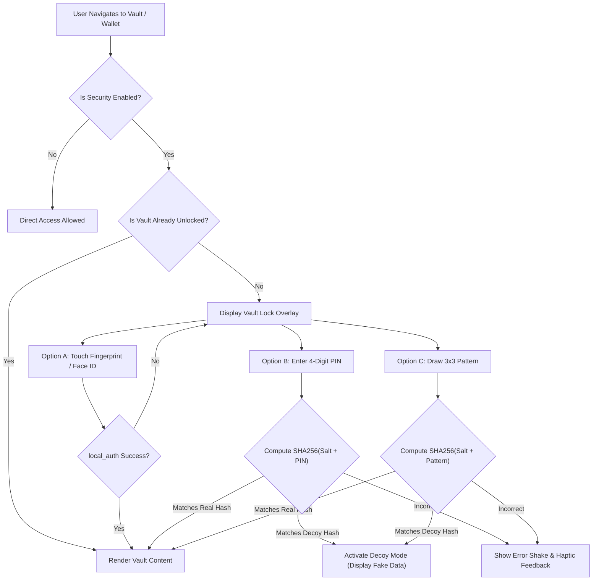

# 🛡️ Secure Vault & Wallet Security Architecture Specification
## Daily Life OS (Biometrics, PIN, Pattern Lock & Hardware Encryption)

> **Document Status:** Approved Specification  
> **Target Modules:** Module 3 (Money & Wallet Manager), Module 5 (Secure Vault & Passwords)  
> **Platform Support:** Android, iOS, Windows, macOS, Web  
> **Last Updated:** 2026-10-23  

---

## 1. Executive Summary & Objectives


The **Daily Life OS** application centralizes sensitive financial records (bank accounts, UPI tags, IOUs, card data) and personal security assets (passwords, Wi-Fi keys, identity credentials, warranty receipts).

To protect user data at rest and in memory, this specification defines a comprehensive, multi-layered security subsystem supporting:
1. **Hardware Biometrics:** Fingerprint scanner, Face ID, and Touch ID via OS-level hardware security chips.
2. **PIN / Password Authentication:** 4 or 6-digit numeric PINs and alphanumeric master passwords.
3. **Pattern Lock:** 3x3 touch-grid gesture drawing.
4. **Decoy / "Panic" PIN Mode:** A secondary duress PIN that unlocks an innocent, decoy screen with dummy data if the user is forced to unlock the app under threat.
5. **Auto-Lock on Inactivity / Backgrounding:** Instant locking whenever the app is minimized or the screen turns off.
6. **Zero Plaintext Storage:** All secrets, PIN hashes, and pattern sequences are encrypted using hardware-backed keychains (**Android Keystore** & **iOS Keychain**).

---

## 2. Essential Flutter Packages & Libraries

| Feature | Recommended Package | Version | Purpose & Architecture Role |
| :--- | :--- | :--- | :--- |
| **Hardware Biometrics** | [`local_auth`](https://pub.dev/packages/local_auth) | `^2.3.0` | Official Flutter team plugin for hardware-backed fingerprint, Face ID, Touch ID, and Windows Hello prompts. |
| **Secure Key Storage** | [`flutter_secure_storage`](https://pub.dev/packages/flutter_secure_storage) | `^9.2.4` *(Included)* | Isolates cryptographic master keys and hashed PINs inside **Android Keystore** (AES hardware encryption) and **iOS Keychain**. |
| **Credential Hashing** | [`crypto`](https://pub.dev/packages/crypto) | `^3.0.6` | Salted SHA-256 and HMAC algorithms so raw PINs and pattern sequences are never stored anywhere in memory or disk. |
| **Pattern Lock UI** | [`pattern_lock`](https://pub.dev/packages/pattern_lock) *(or Custom `CustomPainter`)* | `^2.0.0` | 3x3 dot matrix touch canvas with customizable path lines, dot states, and error animations matching project design tokens. |
| **PIN Dialpad & Keypad** | [`pinput`](https://pub.dev/packages/pinput) | `^5.0.0` | Production-grade 4/6-digit PIN input with obscured secure fields, haptic feedback, cursor animations, and custom styling. |
| **Data Encryption** | [`encrypt`](https://pub.dev/packages/encrypt) | `^5.0.3` | High-level AES-256-GCM cipher for encrypting sensitive SQLite database payload fields (e.g. passwords, warranty attachments). |

---

## 3. Native Operating System Configuration

### A. Android Configuration

#### 1. Biometric Permissions (`android/app/src/main/AndroidManifest.xml`)
Add the biometric permission inside the `<manifest>` root:
```xml
<manifest xmlns:android="http://schemas.android.com/apk/res/android">
    <!-- Required for Fingerprint & Face Biometric Prompt -->
    <uses-permission android:name="android.permission.USE_BIOMETRIC" />
    <uses-permission android:name="android.permission.USE_FINGERPRINT" />
    ...
</manifest>
```

#### 2. FragmentActivity Migration (`MainActivity.kt`)
Android's native `BiometricPrompt` dialog requires the host activity to inherit from `FlutterFragmentActivity` instead of `FlutterActivity`.

Update `android/app/src/main/kotlin/.../MainActivity.kt`:
```kotlin
package com.dailylifeos.app

import io.flutter.embedding.android.FlutterFragmentActivity

class MainActivity : FlutterFragmentActivity() {
    // Custom native bridge handlers can be attached here
}
```

---

### B. iOS Configuration

#### Face ID Permission (`ios/Runner/Info.plist`)
Apple requires declaring the `NSFaceIDUsageDescription` privacy string to inform users why Face ID is accessed:
```xml
<key>NSFaceIDUsageDescription</key>
<string>Biometric authentication is required to unlock your Secure Vault and Wallet.</string>
```

---

## 4. Cryptographic & Security Verification Protocols

```
┌──────────────────────────────────────────────────────────────┐
│                    User Input (PIN / Pattern)                 │
└──────────────────────────────┬───────────────────────────────┘
                               │
                               ▼
┌──────────────────────────────────────────────────────────────┐
│             Generate or Retrieve Cryptographic Salt           │
│           (UUID / 32-Byte CSPRNG securely stored)            │
└──────────────────────────────┬───────────────────────────────┘
                               │
                               ▼
┌──────────────────────────────────────────────────────────────┐
│         HMAC / SHA-256 (Salt + Raw Input Sequence)            │
└──────────────────────────────┬───────────────────────────────┘
                               │
                               ▼
┌──────────────────────────────────────────────────────────────┐
│              Hardware Storage (flutter_secure_storage)       │
│           - Android: EncryptedSharedPreferences / Keystore   │
│           - iOS: SecItemAdd with kSecAttrAccessible          │
└──────────────────────────────────────────────────────────────┘
```

1. **Pattern Serialization:**
   - 3x3 Pattern dots are represented as an index array: `[0, 1, 2, 5, 8]`.
   - The sequence is converted to a canonical string: `"0-1-2-5-8"`.
2. **Salted Hashing Formula:**
   $$\text{StoredHash} = \text{SHA256}(\text{Salt} + \text{Input})$$
3. **Decoy / Panic Key Formula:**
   - Separate entries exist in `flutter_secure_storage`:
     - `vault_primary_hash`: Real user unlock hash.
     - `vault_decoy_hash`: Duress / Decoy mode hash.
     - `vault_salt`: Random cryptographic salt.
4. **Brute-Force Rate Limiting:**
   - After **5 consecutive failed attempts**, enforce a mandatory 30-second cooldown timer.
   - Increment exponential backoff on repeated failures.

---

## 5. Security Architecture (Clean Architecture Pipeline)

Following the project's **Feature-First + Clean Architecture** guidelines:

```
lib/features/security/
├── domain/
│   ├── entities/
│   │   └── security_config_entity.dart
│   ├── repositories/
│   │   └── security_repository.dart
│   └── usecases/
│       ├── authenticate_biometrics_usecase.dart
│       ├── verify_pin_usecase.dart
│       ├── verify_pattern_usecase.dart
│       ├── set_credentials_usecase.dart
│       └── set_decoy_pin_usecase.dart
├── data/
│   ├── datasources/
│   │   ├── security_local_data_source.dart
│   │   └── biometrics_data_source.dart
│   └── repositories/
│       └── security_repository_impl.dart
└── presentation/
    ├── bloc/
    │   ├── security_bloc.dart
    │   ├── security_event.dart
    │   └── security_state.dart
    └── widgets/
        ├── biometric_prompt_pill.dart
        ├── pin_dialpad_widget.dart
        ├── pattern_lock_grid_widget.dart
        └── vault_lock_overlay.dart
```

---

## 6. Complete Unlocking Decision Flow



---

## 7. Auto-Lock & Lifecycle Observer

To ensure security if a user puts their phone down or switches apps, `WidgetsBindingObserver` listens to OS lifecycle events:

```dart
class SecurityLifecycleHandler with WidgetsBindingObserver {
  final VoidCallback onLockRequired;

  SecurityLifecycleHandler({required this.onLockRequired});

  @override
  void didChangeAppLifecycleState(AppLifecycleState state) {
    if (state == AppLifecycleState.paused || state == AppLifecycleState.inactive) {
      // Immediately lock the vault and clear in-memory plaintext credentials
      onLockRequired();
    }
  }
}
```

---

## 8. Implementation Roadmap

1. **Step 1: Dependency Integration**
   - Add `local_auth: ^2.3.0`, `crypto: ^3.0.6`, `pinput: ^5.0.0`, and `pattern_lock: ^2.0.0` to [`pubspec.yaml`](file:///d:/Git%20Repo/Daily_life_OS/pubspec.yaml).
2. **Step 2: Native Manifest Updates**
   - Update `android/app/src/main/AndroidManifest.xml` with `USE_BIOMETRIC`.
   - Update `MainActivity.kt` to extend `FlutterFragmentActivity`.
   - Add `NSFaceIDUsageDescription` to `ios/Runner/Info.plist`.
3. **Step 3: Security Service & Repository**
   - Create `SecurityLocalDataSource` implementing salted SHA-256 storage via `FlutterSecureStorage`.
4. **Step 4: Lock Screen Widgets**
   - Implement `PinDialpadWidget` and `PatternLockGridWidget` styled with [`AppColors.moduleVault`](file:///d:/Git%20Repo/Daily_life_OS/lib/config/theme/app_colors.dart), [`AppRadius`](file:///d:/Git%20Repo/Daily_life_OS/lib/config/theme/app_radius.dart), and dark theme tokens.
5. **Step 5: Connect to Vault & Money Pages**
   - Protect [`VaultPage`](file:///d:/Git%20Repo/Daily_life_OS/lib/features/vault/presentation/pages/vault_page.dart) and `MoneyManagerPage` with the unlock overlay and Decoy mode toggle.


To build a multi-layer security system (Fingerprint / Biometrics, PIN / Password, and Pattern Lock) for the Secure Vault and Wallet modules, here is the complete breakdown of the packages, native OS configurations, and architecture needed:

1. Essential Flutter Packages & Libraries
Feature	Recommended Package	Purpose & Role
Fingerprint & Face ID	local_auth	Official Flutter team plugin for hardware biometrics (Android BiometricPrompt, iOS Touch ID / Face ID, Windows Hello).
Hardware Key Storage	flutter_secure_storage (Already in 

pubspec.yaml
)	Stores master encryption keys, biometric flags, and hashed credentials inside the Android Keystore and iOS Keychain.
Credential Hashing	crypto	Computes salted SHA-256 or PBKDF2 hashes so plain passwords, PINs, or pattern sequences are never stored in plain text.
Pattern Lock	pattern_lock (or Custom CustomPainter)	Provides a 3x3 touch-grid canvas for drawing and verifying unlock patterns.
PIN / Password Input	pinput (or custom dialpad)	Animated 4/6-digit numeric PIN inputs with obscured dots, error animations, and haptic feedback.
Data Encryption	encrypt	High-level AES-256-GCM cipher to encrypt card numbers, credentials, and notes before storing in the SQLite database.
2. Native OS Configurations
A. Android Setup
Biometric Permission in android/app/src/main/AndroidManifest.xml:
xml
<uses-permission android:name="android.permission.USE_BIOMETRIC"/>
FragmentActivity Requirement: Android's BiometricPrompt dialog requires the host activity to extend FlutterFragmentActivity. In android/app/src/main/kotlin/.../MainActivity.kt:
kotlin
import io.flutter.embedding.android.FlutterFragmentActivity
class MainActivity : FlutterFragmentActivity()
B. iOS Setup
In ios/Runner/Info.plist, declare the Face ID usage description:

xml
<key>NSFaceIDUsageDescription</key>
<string>Biometric authentication is required to access your Secure Vault and Wallet.</string>
3. Security Architecture & Core Mechanisms
mermaid
graph TD
    A["User opens Vault / Wallet"] --> B{"Is Vault Locked?"}
    B -- Yes --> C["Vault Lock Screen"]
    C --> D1["Option 1: Fingerprint (local_auth)"]
    C --> D2["Option 2: 4/6-Digit PIN"]
    C --> D3["Option 3: 3x3 Pattern Lock"]
    D1 --> E{"Verify Credential"}
    D2 --> E
    D3 --> E
    E -- Real PIN / Pattern --> F["Unlock Real Vault (Decoy = false)"]
    E -- Decoy / Panic PIN --> G["Unlock Empty Decoy Vault (PRD Safe Mode)"]
    E -- Failed --> H["Show Error & Haptic Vibration"]
    B -- No --> F
Hardware-Backed Credential Verification:
When a user sets a PIN (e.g. 1234) or Pattern (e.g. [0, 1, 2, 5, 8]), generate a cryptographic salt and hash it: $$\text{StoredHash} = \text{SHA256}(\text{Salt} + \text{Input})$$
Store the salt and hash in 

flutter_secure_storage
.
Decoy / Panic PIN Mode (Specified in 

daily_life_os_product_requirements_document.md
):
Allow setting a secondary PIN. If entering this PIN under duress, the app unlocks an innocent-looking decoy screen with dummy data instead of the real private vault.
Auto-Lock on App Backgrounding:
Implement WidgetsBindingObserver so whenever the app transitions to AppLifecycleState.paused or inactive, the vault immediately locks itself.
Biometric Fallback:
If the biometric sensor fails or is not enrolled, gracefully fall back to PIN or Pattern.
Next Steps
Would you like to:

Add local_auth and dependencies to 

pubspec.yaml
 and configure the Android/iOS files?
Build the Lock Screen UI (Biometric prompt + PIN dialpad + Pattern lock) integrated with 

VaultPage
 and 

VaultBloc
?


---------------
Summary of What Is Covered in the Document
Executive Summary & Objectives:
Protecting the Money / Wallet and Secure Vault modules with multi-factor authentication (Biometrics, PIN, Pattern Lock, and Decoy Mode).
Recommended Flutter Packages & Roles:
local_auth for fingerprint, Face ID, and biometric prompts.
flutter_secure_storage for hardware-isolated key storage in the Android Keystore & iOS Keychain.
crypto for salted SHA-256 / PBKDF2 hashing so plain PINs or patterns are never stored in raw text.
pattern_lock for 3x3 touch-matrix gesture authentication.
pinput for smooth, masked 4/6-digit numeric dialpad inputs.
encrypt for AES-256-GCM database field-level encryption.
Native OS Configurations:
Android: Permissions (USE_BIOMETRIC, USE_FINGERPRINT) in AndroidManifest.xml and migrating MainActivity to FlutterFragmentActivity.
iOS: NSFaceIDUsageDescription privacy declaration in Info.plist.
Cryptographic & Verification Protocols:
Salt generation and salted SHA-256 formula: $\text{StoredHash} = \text{SHA256}(\text{Salt} + \text{Input})$.
Brute-force rate limiting (cooldown after 5 consecutive failures).
Decoy / Panic Mode:
Secondary emergency PIN that unlocks an innocent, decoy screen if the user is coerced into unlocking under threat.
Auto-Lock on Inactivity / Backgrounding:
WidgetsBindingObserver lifecycle listener to auto-lock whenever the app enters AppLifecycleState.paused or inactive.
Mermaid Flow Diagram & Clean Architecture Roadmap:
Full decision tree diagram and step-by-step implementation guide across domain, data, and presentation layers.