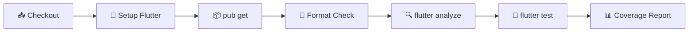
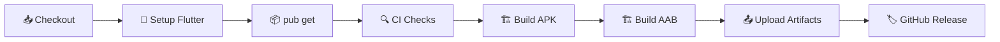

# 🚀 CI/CD Pipeline — Implementation Plan

## What is CI/CD? (Beginner Explanation)

```
  You (Developer)
       │
       ▼
  ┌─────────┐     push / PR      ┌──────────────────────────────────────────┐
  │  Local   │ ──────────────────▶│          GitHub Actions  (Cloud)        │
  │  Code    │                    │                                          │
  └─────────┘                    │  CI ─ Continuous Integration              │
                                  │  ┌──────────────────────────────────┐    │
                                  │  │ 1. 📥 Checkout code              │    │
                                  │  │ 2. 🔧 Setup Flutter SDK          │    │
                                  │  │ 3. 📦 Install dependencies       │    │
                                  │  │ 4. 🔍 Lint & Static Analysis     │    │
                                  │  │ 5. 🧪 Run all tests              │    │
                                  │  │ 6. 📊 Upload coverage report     │    │
                                  │  └──────────────────────────────────┘    │
                                  │                                          │
                                  │  CD ─ Continuous Delivery                │
                                  │  ┌──────────────────────────────────┐    │
                                  │  │ 7. 🏗️ Build APK / AAB            │    │
                                  │  │ 8. 📤 Upload build artifacts     │    │
                                  │  │ 9. 🏷️ Create GitHub Release      │    │
                                  │  └──────────────────────────────────┘    │
                                  └──────────────────────────────────────────┘
```

### In Plain English

| Term | What it means |
|------|---------------|
| **CI** (Continuous Integration) | Every time you push code, a robot automatically checks your code for errors, runs tests, and tells you if anything is broken — *before* it reaches your users. |
| **CD** (Continuous Delivery) | After CI passes, the robot automatically builds your app (APK/AAB) and makes it downloadable — ready to ship to the Play Store. |
| **Pipeline** | The full sequence of automated steps (lint → test → build → release). |
| **GitHub Actions** | GitHub's built-in CI/CD system. Free for public repos, 2000 minutes/month for private repos. **Industry standard** for GitHub-hosted projects. |

---

## Why This Matters (Industry Context)

> [!IMPORTANT]
> **Every professional app** — Google, Meta, Spotify, Uber — uses CI/CD pipelines. It's not optional, it's fundamental.

| Benefit | Without CI/CD | With CI/CD |
|---------|--------------|------------|
| **Bug Detection** | Find bugs after users complain 😬 | Catch bugs before merge ✅ |
| **Code Quality** | Forget to run tests locally | Tests run automatically on every push |
| **Build Consistency** | "Works on my machine" problem | Identical builds every time |
| **Release Speed** | Manual APK building, hours of work | One-click releases in minutes |
| **Team Confidence** | Afraid to merge code | Green badge = safe to merge |

---

## Industry Best Practices We'll Follow

### 1. The "Trunk-Based" Branching Strategy

```
  main  ────●────●────●────●────●────▶  (always stable, deployable)
             ╲       ╱    ╲       ╱
  dev   ──────●─●─●────────●─●─●──▶     (integration branch)
               ╲ ╱          ╲ ╱
  feature/ ─────●────        ─●──        (short-lived feature branches)
```

| Branch | Purpose | CI Runs? | CD Runs? |
|--------|---------|----------|----------|
| `main` | Production-ready code | ✅ Full CI | ✅ Build + Release |
| `dev` | Integration testing | ✅ Full CI | ✅ Build (debug APK) |
| `feature/*` | New features | ✅ Full CI | ❌ No builds |

### 2. Fail-Fast Principle
- Run **cheapest checks first** (lint takes 30s, tests take 2min, builds take 5min).
- If lint fails → don't waste time running tests.
- If tests fail → don't waste time building APK.

### 3. Caching Strategy
- Cache Flutter SDK + pub dependencies → **saves 2-3 minutes per run**.
- Cache Gradle build → **saves 1-2 minutes on Android builds**.

### 4. Security Best Practices
- **Never commit secrets** (signing keys, API keys) to the repo.
- Use **GitHub Secrets** for sensitive values (keystore passwords, `.env` contents).
- Use **GitHub Environments** to control who can trigger releases.

---

## What We'll Create

### File Structure

```
Daily_life_OS/
├── .github/
│   └── workflows/
│       ├── ci.yml              ← Runs on every push & PR (lint + test)
│       └── release.yml         ← Runs on version tags (build + release)
```

---

## Phase 1: CI Workflow — `.github/workflows/ci.yml`

> Triggers on every `push` to `main`/`dev` and every `pull_request`.

### Pipeline Steps



### Detailed Breakdown

| Step | Command | Purpose | Time |
|------|---------|---------|------|
| **Checkout** | `actions/checkout@v4` | Clone your repo to the runner | ~5s |
| **Setup Flutter** | `subosito/flutter-action@v2` | Install exact Flutter SDK version | ~30s (cached) |
| **Dependencies** | `flutter pub get` | Install all packages | ~15s (cached) |
| **Format** | `dart format --set-exit-if-changed .` | Enforce consistent code style | ~10s |
| **Analyze** | `flutter analyze --fatal-infos` | Static analysis (lint errors, warnings) | ~30s |
| **Test** | `flutter test --coverage` | Run all 45+ tests with coverage | ~60s |
| **Coverage** | Upload `lcov.info` | Track test coverage over time | ~5s |

### Key Configuration Choices

```yaml
# Workflow trigger strategy
on:
  push:
    branches: [main, dev]      # Run CI on pushes to main & dev
  pull_request:
    branches: [main, dev]      # Run CI on PRs targeting main & dev

# Runner choice
runs-on: ubuntu-latest         # Free, fast Linux runners (recommended)
                                # macOS runners cost 10x more

# Flutter version pinning
flutter-version: '3.32.x'     # Pin to your current SDK series
channel: 'stable'              # Always use stable channel
cache: true                    # Cache Flutter SDK between runs
```

### Cost

| Runners | Cost (Public Repo) | Cost (Private Repo) |
|---------|-------------------|---------------------|
| Ubuntu (Linux) | **Free** ∞ | 2,000 min/month free |
| macOS | **Free** ∞ | 200 min/month free (10x cost) |
| Windows | **Free** ∞ | 2,000 min/month free |

> [!TIP]
> Your repo (`maheshmudem/Daily_life_OS`) is on GitHub → **Ubuntu runners are the best choice** for CI. They're fast, free, and sufficient for Flutter analysis + testing.

---

## Phase 2: Release Workflow — `.github/workflows/release.yml`

> Triggers when you push a version tag like `v1.0.0`.

### Pipeline Steps



### How to Trigger a Release

```bash
# Tag the current commit with a version
git tag v1.0.0

# Push the tag to GitHub → triggers the release workflow
git push origin v1.0.0
```

### Build Outputs

| Artifact | Format | Purpose |
|----------|--------|---------|
| **APK** (Debug) | `.apk` | Direct install for testing |
| **APK** (Release) | `.apk` | Direct install for distribution |
| **AAB** (App Bundle) | `.aab` | Upload to Google Play Store |

### GitHub Release

The workflow will automatically:
1. Create a **GitHub Release** page with the tag name.
2. Attach the built APK and AAB as **downloadable assets**.
3. Auto-generate **release notes** from commit messages since the last tag.

---

## Phase 3: Status Badges (Professional Touch)

Add a CI status badge to your `README.md`:

```markdown

```

This shows a live ✅ or ❌ badge — **instantly tells visitors if your project is healthy**.

---

## Popular Tools Used by Industry Leaders

| Company | CI/CD Tool | Why |
|---------|-----------|-----|
| **Google** | GitHub Actions + Cloud Build | Open source uses GH Actions |
| **Meta** | GitHub Actions + Custom | Most OSS repos use GH Actions |
| **Spotify** | GitHub Actions | Flutter app uses GH Actions |
| **Alibaba** | GitHub Actions + Jenkins | Public repos on GH Actions |
| **Very Good Ventures** | GitHub Actions | Flutter agency, sets industry standards |
| **BMW** | GitHub Actions + Codemagic | Mobile team uses both |

> [!NOTE]
> **GitHub Actions** is the #1 choice for GitHub-hosted projects. Other popular options include **Codemagic** (Flutter-specific, visual pipeline builder), **Bitrise** (mobile-focused), and **CircleCI**. We're going with GitHub Actions because your code is already on GitHub and it requires zero additional setup.

---

## Security Considerations

### Secrets Management

| Secret | Where to Store | How to Use |
|--------|---------------|------------|
| `.env` contents | GitHub Secrets → `ENV_FILE` | Injected at build time |
| Android Keystore | GitHub Secrets → `KEYSTORE_BASE64` | Decoded during release build |
| Keystore password | GitHub Secrets → `KEYSTORE_PASSWORD` | Used for signing |
| Key alias & password | GitHub Secrets → `KEY_ALIAS`, `KEY_PASSWORD` | Used for signing |

> [!WARNING]
> **Never commit your keystore, `.env`, or passwords to the repository.** Always use GitHub Secrets (Settings → Secrets and variables → Actions).

### Setting Up GitHub Secrets (Step-by-step)

```
GitHub Repo → Settings → Secrets and variables → Actions → New repository secret
```

For now (Phase 1 CI), **no secrets are needed**. We'll set up signing secrets when you're ready for Play Store deployment.

---

## Implementation Summary

| Phase | What | Files Created | Trigger |
|-------|------|---------------|---------|
| **Phase 1** | CI Pipeline (lint + test) | `.github/workflows/ci.yml` | Push to `main`/`dev`, PRs |
| **Phase 2** | Release Pipeline (build + release) | `.github/workflows/release.yml` | Push tag `v*` |
| **Phase 3** | README Badge | Update `README.md` | N/A (visual) |

### Estimated Pipeline Times

| Stage | Time |
|-------|------|
| Full CI (lint + test) | **~2-3 minutes** |
| Release (CI + build APK + AAB) | **~5-7 minutes** |

---

## What Happens After You Approve

1. Create `.github/workflows/ci.yml` — the CI pipeline.
2. Create `.github/workflows/release.yml` — the release pipeline.
3. Update `README.md` with the CI status badge.
4. Run `flutter analyze` and `flutter test` locally to verify everything passes before the first push.
5. Walk you through how to push and see your first green pipeline ✅.

---

> [!TIP]
> **Next Level (Future)**: Once comfortable, we can add **Codemagic** for one-click Play Store deployment, **Fastlane** for automated screenshots, or **Firebase App Distribution** for beta testing — but let's nail the fundamentals first.
